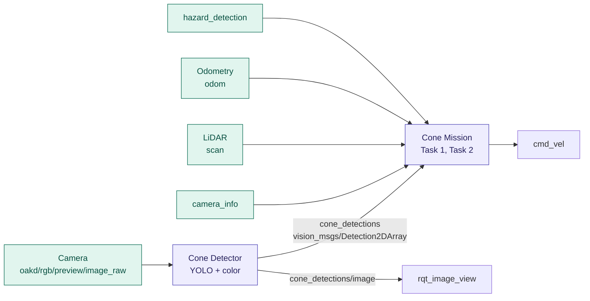

# cs5335_cone_finder

Python package for CS 5335 Project 9 (Computer Vision), a rewrite of `day9pkg` that finds
the cones with **YOLO** instead of color masks. Two nodes work together:

- **Cone Detector** (`cone_detector`): finds traffic cones in the camera image with a YOLO
  model and names each one's color.
- **Cone Mission** (`cone_mission`): drives the TurtleBot 4.
  - **Task 1**: remembers where it starts (the **origin**), turns in place, and records the
    **first three cones** it sees: each one's **color**, **bearing** and **distance** (from
    the LiDAR).
  - **Task 2**: drives to about an inch from cone 1, **comes back to the origin**, then
    cone 2 and back, then cone 3 and back, and stops. No input is needed once it starts.

## The idea in short

The camera can tell **which** object is a cone and **which way** it is, but not well how
far away it is, and up close it no longer sees the whole cone. The LiDAR is the opposite:
it measures distance to within millimeters but cannot tell a cone from a chair. So YOLO
points, the LiDAR measures, and odometry remembers where the origin is.

```text
Task 1:
    remember the origin (odometry pose)
    turn in place slowly
        each image: YOLO finds the cones, the pixels in each box give its color
        sightings in the same direction are one cone; keep the first three
    stop; in a LiDAR scan, the nearest object in each cone's direction is that cone
    log each cone's color, bearing and distance

Task 2, for cone 1, 2, 3:
    turn toward where Task 1 put the cone
    turn until it is in the middle of the image        <- camera (YOLO)
    the nearest LiDAR object in its direction is it     <- LiDAR
    drive to it, following it in the scans; stop about an inch away
    turn around, drive back to the origin, face the start heading   <- odometry
```



The code that needs no ROS is in its own modules and has unit tests: `geometry.py`
(LiDAR points, gaps, velocity commands), `vision.py` (pixel to bearing), `color.py`
(naming a cone's color), `yolo_detector.py` (running YOLO), `cone_recorder.py` (grouping
sightings into cones) and `pose_history.py` (where the robot was when an image was taken).
`cone_detector.py` and `cone_mission.py` are the nodes.

## How the Cone Detector finds a cone

1. **YOLO-World.** The standard (COCO) YOLO models have no traffic-cone class.
   YOLO-World is a YOLO model that finds objects from a text prompt, so with the prompt
   `traffic cone` it finds cones without any training. `model` can also point to a YOLO
   model you trained on cones; then `classes` lists which of its classes are cones.
2. **The color comes from the pixels, not from YOLO.** YOLO only says "traffic cone". In
   the middle 60% of each box (`color_region`), each pixel is converted to HSV. Pixels that
   are too gray (`min_saturation`) or too dark (`min_value`) are skipped, which leaves out
   the floor, the wall behind and the cone's white stripe. The color whose hue range
   (`hue_ranges`) holds the most pixels names the cone, if it holds at least
   `min_color_fraction` of them; otherwise the color is `unknown`. Hue is used rather than
   RGB because it stays about the same in light and shadow. Red sits at both ends of the hue
   scale (OpenCV's hue runs 0-179), so its range wraps through 0.
3. **What it publishes.** For every image, a `vision_msgs/Detection2DArray` on
   `cone_detections` with the image's header. In each detection,
   `results[0].hypothesis.class_id` is the color and `score` YOLO's confidence. The box
   center is in pixels with pixel (i, j) centered at (i, j), the convention of
   `camera_info`. The same image with the cones boxed goes to `cone_detections/image`.

## How the Cone Mission works

### Task 1: the first three cones

- **Where a cone is.** With the pinhole model, a cone whose box center is at column u is at
  the bearing atan((cx - u) / fx) from straight ahead (+ = left); fx and cx come from
  `camera_info`. Adding the robot's heading **when the image was taken** gives the cone's
  direction in the odom frame. YOLO takes a noticeable part of a second per image, so the
  node keeps 5 s of odometry and looks the heading up by the image's timestamp. This needs
  the robot's two computers (the Create 3, which stamps odometry, and the Raspberry Pi,
  which stamps images and scans) to agree on the time. If a stamp lags the newest odometry
  by more than `max_detection_lag` (or `max_scan_lag` for scans), or is ahead of it, the
  node warns and uses the pose when the data arrived instead. At the start it logs how far
  the stamps lag, so you can see whether the clocks agree.
- **One cone, many images.** As the robot turns, the same cone shows up in many images.
  Sightings within `same_cone_angle` of each other are one cone. Only sightings within
  `scan_band` of the image center count, where the bearing is most accurate.
- **The first three.** A cone counts once it has been seen `min_sightings` times, so a
  one-off false detection does not take a place. The first `max_cones` (3) to count are
  numbered 1, 2, 3 in the order they were first seen. The turn ends once each of them has
  been seen within `scan_center_tolerance` of the image center, or after one full turn
  (plus `scan_band`).
- **Its color** is the color most of its sightings agree on.
- **Its distance.** In a scan taken after the robot has stopped, the nearest LiDAR points in
  the directions the cone covered in the image (plus `bearing_margin`) are the cone. The
  wall behind it is farther away, and `cluster_depth` keeps it out. The distance is from
  the robot's center to the nearest of those points (the near side of the cone).

The log then lists each cone. Format only (not from a real run):

```text
Cones found (bearing from the start heading: 0 = ahead, + = left; distance from the robot's center to the near side of the cone, by LiDAR):
  cone 1  orange    +46 deg  0.98 m
  cone 2  green    +166 deg  0.98 m
  cone 3  blue      -69 deg  1.01 m
```

### Task 2: each cone, then back to the origin

For each cone in order:

1. **Face it.** Turn in place toward the position Task 1 found.
2. **Center it in the image.** Each detection gives the cone's direction in the odom frame,
   and the robot turns toward it by odometry, so YOLO's delay does not make it overshoot.
   Only detections within `same_cone_angle` of the expected direction count, preferring
   ones of the cone's color, so it does not lock on to another cone. Once within
   `center_tolerance` it stops and checks again in a still image. If the cone is not in
   view, it turns left until it is, for at most one full turn.
3. **Lock on with the LiDAR**, the same way Task 1 measured it.
4. **Drive to it.** With each new scan, the points within `track_gate` of the cone's last
   position are the cone, so the robot keeps following it once it is too close for the
   camera to see it whole. It steers toward the points and slows down as the gap closes.
   If the newest scan does not show the cone, it waits instead of driving on old data. If
   anything other than the cone is within `front_clearance` ahead, it gives up on this
   cone.
5. **Come back.** Turn toward the origin, drive back by odometry, and turn to face the
   start heading. While driving back, it stops if any LiDAR point is within
   `front_clearance` in front of it.

If a cone cannot be reached (lost, not found, too far), the robot goes back to the origin
and goes on with the next cone. If it cannot get back to the origin, the mission stops.

**Where it stops.** The LiDAR sees a cone about 19 cm above the floor, where the cone is
narrower than at its base, but the robot's bumper is at the bottom. So the robot stops
when the LiDAR's gap is `stop_gap` + `cone_base_extra`:

```text
              LiDAR (about 19 cm up)
   robot  |<--- gap the LiDAR measures --->/  cone side at 19 cm
          |                               /
          |                             /
  bumper  |<-- stop_gap -->|<- cone_base_extra ->|  base
```

**The origin is kept in odometry.** Odometry drifts a little with every drive, so after a
few trips "the origin" may be a few centimeters from where the robot really started. Each
trip to a cone re-finds the cone with the camera and LiDAR, so drift does not add up there.

## Set up in the lab

- Three cones in a triangle, at least 1.5 m apart, with nothing else that looks like a cone
  inside it.
- The cones must be taller than the LiDAR (about 20 cm), or the LiDAR cannot see them.
- The robot off the dock (the LiDAR and camera may be off while docked), near the middle of
  the triangle, with room to drive to each cone and back.

## Install

The package needs `vision_msgs`, `cv_bridge`, OpenCV, NumPy, the Create 3's messages and
the Python package `ultralytics`. From the workspace root (`robotics_ws`):

```bash
rosdep install -i --from-path src/cs5335_cone_finder --rosdistro jazzy -y --skip-keys python3-ultralytics-pip
```

`ultralytics` comes from pip (its rosdep key is `python3-ultralytics-pip`). Ubuntu 24.04
blocks pip from installing next to the system's Python packages unless you pass
`--break-system-packages`. Install PyTorch's CPU-only build first, since the default build
downloads several GB of GPU libraries:

```bash
pip install --break-system-packages torch torchvision --index-url https://download.pytorch.org/whl/cpu
```

```bash
pip install --break-system-packages ultralytics
```

Then, **with internet access**, load the model once. This downloads the YOLO-World weights
(into the current directory) and the text model it uses for the prompt:

```bash
python3 -c "from ultralytics import YOLO; m = YOLO('yolov8s-worldv2.pt'); m.set_classes(['traffic cone']); print('ok')"
```

Run the nodes from that same directory, or set `model` to the weights file's full path.

## Build

From the workspace root:

```bash
colcon build --packages-select cs5335_cone_finder
```

```bash
source install/setup.bash
```

## Run

**First, check YOLO without moving the robot.** Start only the Cone Detector:

```bash
ros2 run cs5335_cone_finder cone_detector --ros-args --params-file src/cs5335_cone_finder/config/cone_finder.yaml
```

and watch the boxes in another terminal:

```bash
ros2 run rqt_image_view rqt_image_view /cone_detections/image
```

Each cone should get a box labeled with the right color. If a color is wrong or
`unknown`, adjust `hue_ranges`, `min_saturation` or `min_value`; if cones are missed, lower
`confidence`.

**Then the whole mission.** With the robot set up as above and someone ready to lift it:

```bash
ros2 launch cs5335_cone_finder cone_finder_launch.py params_file:=src/cs5335_cone_finder/config/cone_finder.yaml
```

The Cone Mission waits until odometry, LiDAR scans, `camera_info` and the first detections
have arrived, waits `start_delay` (3 s) more, and then **moves on its own** until it has
visited every cone and come back. Ctrl-C stops it at any time.

Without `params_file:=...`, the launch file uses the copy of `cone_finder.yaml` installed
by `colcon build`; with it, edits to the file in `src` take effect on the next run without
rebuilding. Parameters are read once when a node starts, so restart after editing.

## Parameters

All of them can be set in `config/cone_finder.yaml` or with `-p name:=value`. Units are SI.

### Cone Detector (`cone_detector`)

| Parameter | Default | Meaning |
| --- | --- | --- |
| `model` | `yolov8s-worldv2.pt` | YOLO model file, or a name ultralytics downloads on first use |
| `classes` | `['traffic cone']` | Text prompts for YOLO-World; for another model, its class names that are cones |
| `confidence` | 0.2 | Minimum YOLO confidence (0-1) |
| `image_size` | 320 | Size (px) images are scaled to for YOLO |
| `device` | `''` | `'cpu'`, `'0'` for the first GPU, or `''` for automatic |
| `image_topic` | `oakd/rgb/preview/image_raw` | Camera image topic |
| `publish_image` | true | Publish the image with the cones boxed on `cone_detections/image` |
| `colors` | all seven | Colors a cone may have: `red`, `orange`, `yellow`, `green`, `blue`, `purple`, `pink` |
| `hue_ranges.<color>` | see the YAML file | Hue range `[low, high]` of each color (OpenCV scale 0-179; low > high wraps through 0) |
| `min_saturation` | 80 | Minimum saturation (0-255) of a pixel that counts toward a color |
| `min_value` | 60 | Minimum value, or brightness, (0-255) of a pixel that counts |
| `min_color_fraction` | 0.15 | Fraction of the pixels looked at that must have a color to name it |
| `color_region` | 0.6 | Fraction of the box's width and height (centered) whose pixels decide the color |

### Cone Mission (`cone_mission`)

| Parameter | Default | Meaning |
| --- | --- | --- |
| `detections_topic` | `cone_detections` | The Cone Detector's output |
| `camera_info_topic` | `oakd/rgb/preview/camera_info` | Calibration of the camera the detector uses (same resolution) |
| `hfov` | 1.204 rad (69 deg) | Field of view, used only if `camera_info` has no calibration |
| `max_cones` | 3 | How many cones to record and visit |
| `min_sightings` | 2 | Sightings a cone needs before it counts |
| `scan_speed` | 0.3 rad/s | Turn speed while looking for cones (Task 1, and searching in Task 2) |
| `scan_band` | 0.3 rad | Only cones within this angle of the image center count in Task 1 |
| `scan_center_tolerance` | 0.09 rad | Each recorded cone must be seen this close to the image center |
| `same_cone_angle` | 0.35 rad | Sightings this close together are one cone |
| `center_tolerance` | 0.035 rad | How centered a cone must be before driving to it |
| `turn_tolerance` | 0.087 rad | Heading error at which a turn in place is done |
| `max_linear_speed` | 0.15 m/s | Top forward speed (the TurtleBot 4 can do 0.31) |
| `min_linear_speed` | 0.02 m/s | Slowest forward speed while driving |
| `linear_gain` | 0.5 1/s | Forward speed per meter still to go |
| `max_angular_speed` | 0.8 rad/s | Top turn speed (the TurtleBot 4 can do 1.9) |
| `min_angular_speed` | 0.1 rad/s | Slowest turn speed |
| `angular_gain` | 1.5 1/s | Turn speed per radian of heading error |
| `turn_first` | 0.35 rad | Turn in place before driving if the target is farther off |
| `robot_radius` | 0.171 m | Radius of the robot (0.342 m across) |
| `stop_gap` | 0.025 m | Gap to leave between the robot and the base of a cone |
| `cone_base_extra` | 0.06 m | How much farther a cone's base sticks out than its side at the LiDAR's height |
| `bearing_margin` | 0.07 rad | Widen the camera's view of a cone by this when looking in a scan |
| `cluster_depth` | 0.15 m | LiDAR points up to this much behind the nearest are the cone too |
| `track_gate` | 0.2 m | LiDAR points this close to the cone's last position are the cone |
| `lost_time` | 1.0 s | Give up on a cone the LiDAR has not seen for this long |
| `max_cone_range` | 4.0 m | Anything farther away is not a cone |
| `origin_tolerance` | 0.05 m | How close to the origin counts as back |
| `front_clearance` | 0.2 m | On the way back, stop if anything is this close in front |
| `rate_hz` | 20.0 Hz | Control loop rate |
| `settle_time` | 0.5 s | Wait after stopping before taking a still image or scan |
| `data_timeout` | 0.5 s | Stop if odometry or scans are older than this |
| `move_timeout` | 60.0 s | Give up on one move after this |
| `start_delay` | 3.0 s | Wait once all data is in, before moving |
| `data_wait` | 60.0 s | Give up if the data has not all arrived by then |
| `max_scan_lag` | 0.5 s | A scan stamp lagging the odometry by more means the clocks disagree |
| `max_detection_lag` | 1.0 s | Same for an image's detections (includes YOLO's time) |
| `use_tf` | true | Look up where the LiDAR sits on the robot in TF |
| `lidar_mount` | `[-0.04, 0.0, 1.5708]` | LiDAR position `[x m, y m, yaw rad]` if `use_tf` is false |

## Safety

The robot stops (zero velocity, sent three times) when the mission ends, on Ctrl-C or a
closed terminal, and on any of:

| Event | What happens |
| --- | --- |
| Bump, cliff, wheel stall or wheel drop (`hazard_detection`) once the mission has started, even while standing still | The mission stops at the next control step |
| Odometry or LiDAR scans stop arriving | The mission stops (older than `data_timeout`, 0.5 s) |
| Something in front on the way back | The mission stops (`front_clearance`, 0.2 m) |
| Cannot get back to the origin | The mission stops |
| Something other than the cone in front while driving to it | That cone is skipped; back to the origin |
| The cone is missing from the newest scan | The robot waits; after `lost_time` (1 s) that cone is skipped |
| The cone is not found in the image | That cone is skipped; back to the origin |
| One move takes too long | `move_timeout`, 60 s |

Speeds stay at or below 0.15 m/s and 0.8 rad/s, and a velocity that is not a number is
replaced by zero. The Create 3's own protections stay on. If no `hazard_detection` message
has arrived by the start, the node warns that it may not see bumps or cliffs. The detector
never moves the robot. Test first with someone ready to lift the robot.

## Testing without the robot

The modules without ROS have unit tests on synthetic images, points and a stand-in YOLO
model, including a simulated drive to a point. From this package's directory:

```bash
python3 -m pytest test/test_geometry.py test/test_vision.py test/test_color.py test/test_pose_history.py test/test_cone_recorder.py test/test_yolo_detector.py
```

`colcon test --packages-select cs5335_cone_finder` also runs `test_parameters.py` (it needs
rclpy) and the copyright, flake8 and pep257 checks.

## Check on the robot first

Not yet run on the robot, with a real YOLO model, or built with colcon. Check these first:

| What | How |
| --- | --- |
| YOLO-World finds the lab's cones, and their colors are right | Run only `cone_detector` and watch `cone_detections/image` (see Run) |
| How fast the detector runs on the laptop | `ros2 topic hz /cone_detections` |
| The camera's preview topic and its `camera_info` match (same width) | `timeout 5 ros2 topic echo /oakd/rgb/preview/camera_info --once` |
| The robot's clocks agree (image and scan stamps vs odometry stamps); if not, the node warns and uses the pose when the data arrived | The `Sensor stamps behind the newest odometry` line the Cone Mission logs at the start (a few tenths of a second is normal) |
| `vision_msgs` fields as used here | `ros2 interface show vision_msgs/msg/Detection2D` |
| `cmd_vel` takes `TwistStamped` | `ros2 topic info -v /cmd_vel` |
| `hazard_detection` gets through (if not, the bump stop is off) | `timeout 5 ros2 topic echo /hazard_detection --once` |
| The camera is on the robot's center line and faces straight ahead (the bearing math assumes it) | `ros2 run tf2_ros tf2_echo base_link oakd_rgb_camera_frame` |
