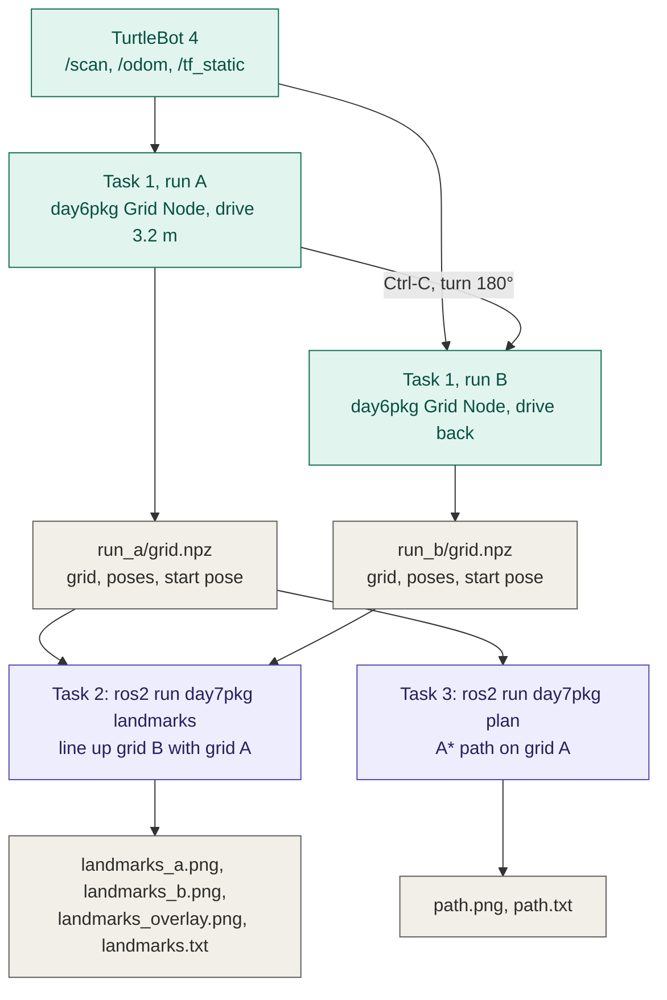
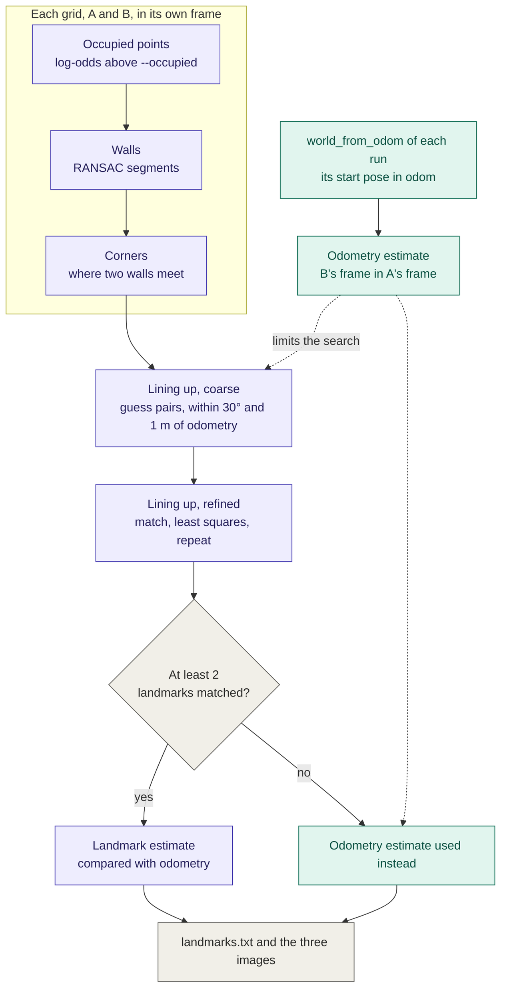
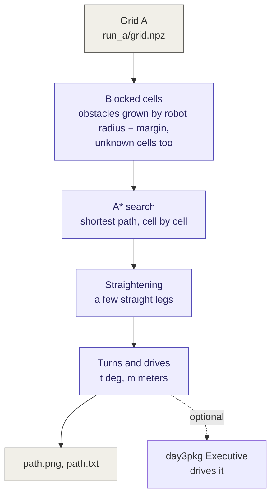

# day7pkg

Python package for CS 5335 Project 7 (Landmarks and Path Planning). It works on the
occupancy grids that [`day6pkg`](../day6pkg/README.md)'s Grid Node saves as `grid.npz`:



Green runs on the robot, gray are saved files, purple are the offline tools.

`landmarks` and `plan` are command-line tools, not ROS nodes: they read saved files, so
they run without the robot and never move it. The algorithms are in `landmarks.py`
(RANSAC, corners, lining up two grids) and `planner.py` (A*), the images in `draw.py`.

## Build

The tools need `day6pkg` (for the grid), NumPy and OpenCV. From the workspace root
(`robotics_ws`):

```bash
colcon build --packages-select day6pkg day7pkg
source install/setup.bash
```

Rebuild both whenever a Python file changes.

## Task 1: two occupancy grids

Drive at least 3 m away from the start (straight: 3.2 m), turn around 180 degrees, and drive
back along the same path. The Grid Node runs once for each way, so each run gets its own
grid and frame: origin at the sensor's position when that run started, x along the robot's
heading then. Grid B is therefore about grid A turned 180 degrees and moved about 3.3 m
(3.2 m driven, plus twice the LiDAR's 4 cm offset behind the robot's center, because turning
about the center swings the LiDAR to its other side; the Grid Node reads the offset from TF,
so you don't need to measure it).

Set up first:

- A straight strip of floor about 3.5 m long, in a room with walls and corners nearby.
- Two or three boxes 0.5 to 1 m beside the path, not on it. Their corners are landmarks
  for Task 2, and one of them is the obstacle for Task 3.
- Nobody walking in view of the LiDAR during the runs: people become obstacles and
  false landmarks.
- Mark the start on the floor with tape.

Then, with the robot undocked and on the tape facing along the path (one terminal for the
Grid Node, one for driving):

1. Terminal 1: start the Grid Node for the run there, and wait for `Update 1`:

   ```bash
   ros2 run day6pkg mapper --ros-args -p output_dir:=run_a -p size:=300 -p snapshot_distances:="[0.0, 1.0, 2.0, 3.0]"
   ```

2. Terminal 2: drive 3.2 m at 0.1 m/s:

   ```bash
   ros2 action send_goal /drive_distance irobot_create_msgs/action/DriveDistance "{distance: 3.2, max_translation_speed: 0.1}"
   ```

3. Terminal 1: when it has stopped, press Ctrl-C. The Grid Node saves `run_a/grid.npz`
   and `run_a/grid_final.png`. Stop it before turning, so the turn is not in grid A and
   grid B starts with its own frame.

4. Terminal 2: turn around:

   ```bash
   ros2 action send_goal /rotate_angle irobot_create_msgs/action/RotateAngle "{angle: 3.14159, max_rotation_speed: 0.5}"
   ```

5. Terminal 1: start the Grid Node for the run back, and wait for `Update 1`:

   ```bash
   ros2 run day6pkg mapper --ros-args -p output_dir:=run_b -p size:=300 -p snapshot_distances:="[0.0, 1.0, 2.0, 3.0]"
   ```

6. Terminal 2: drive back the same 3.2 m (step 2's command again).

7. Terminal 1: Ctrl-C. Now `run_b/grid.npz` is saved too.

Notes:

- `size:=300` makes the grid 15 m across, so walls up to 7.5 m from the start still fit.
- The grid is updated after every 0.1 m of travel (the Grid Node's `update_distance`), with
  5 cm cells; the logs show `Update 1` to `Update 33`.
- Do not restart the robot or reset its pose between the runs: Task 2 compares the
  landmarks with odometry's estimate of where grid B sits in grid A, which needs both runs
  to share the odom frame.
- The Grid Node measures travel as the straight-line distance from the start, so a straight
  path is the simplest. A curved one would need that changed to the path length.
- Worth recording everything once, to redo the grids later without the robot:
  `ros2 bag record /scan /odom /tf /tf_static`.

## Task 2: landmarks

```bash
ros2 run day7pkg landmarks run_a/grid.npz run_b/grid.npz --output-dir results
```

How it finds and compares the landmarks, in short: find the straight walls, take the
corners where two walls meet as landmarks, then find the move and turn that puts B's
corners on top of A's.



Purple comes from the landmarks, green from odometry. Odometry only limits the search, and
stands in when too few landmarks match.

1. **Occupied points.** Each cell the LiDAR clearly saw as occupied becomes one point, at
   the cell's center. "Clearly" means log-odds above `--occupied` (default 1.0): at least
   two more scans saw the cell as occupied (a ray ended in it) than as free (a ray passed
   through it), which drops most one-off stray hits.
2. **Walls (RANSAC).** The points are noisy and belong to many different walls, so one line
   fitted to all of them would mean nothing. Instead, walls are found one at a time, by
   guessing and checking:
   - Pick a random point and a second random point near it (within `--sample-radius`,
     0.5 m), and draw the line through the two.
   - Collect the points close to that line (within `--inlier-distance`, 5 cm). Keep only
     the unbroken stretch around the first point: a gap longer than `--max-gap` (15 cm),
     such as a doorway, ends it.
   - If the stretch has enough points (`--min-points`, 8), fit the best line through
     them, collect the points again, and keep the result as a wall segment if it is long
     enough (`--min-length`, 0.3 m).
   - Remove that segment's points and guess again. Stop after `--max-failures` (300)
     guesses in a row find nothing.

   `--seed` fixes the random guesses, so the same grid always gives the same segments.
3. **Corners (the landmarks).** Where two segments meet at `--corner-angle` (60 degrees)
   or more, and both run right up to the meeting point (each ends within
   `--corner-distance`, 15 cm, of it), the meeting point is a landmark. Corners make good
   landmarks: they are easy to pick out, they don't move between the runs, and each has
   one exact position. A straight wall has no such position, because every point along it
   looks the same. Corners closer together than `--corner-distance` count as one.
4. **Lining up grid B with grid A.** Each run has its own frame, so the same corner has
   different coordinates in A and in B. To find the move and turn between the two frames
   (the assignment's hint):
   - Take one landmark of A and one of B, guess that they are the same corner, and move B
     so the two coincide.
   - Turn B about that point in 1-degree steps, and at each step count how many of B's
     landmarks land within `--match-distance` (0.3 m) of one of A's.
   - Do this for every pair and keep the move and turn with the highest count (on a tie,
     the smallest total distance).
   - Fine-tune it with a least-squares fit to the landmarks that matched.

   Only moves within 1 m and turns within 30 degrees of odometry's estimate are tried. A
   rectangular room looks the same turned 180 degrees, so without this limit it could be
   lined up the wrong way round. `--no-prior` removes the limit.
5. **Comparing.** After lining up, a landmark of A and a landmark of B are the same one if
   each is the other's nearest and they are within `--match-distance` of each other. The
   rest were found in one grid only, e.g. a box corner the LiDAR saw from one side only.

What it writes to `--output-dir`, for the instructor:

| File | Contents |
| --- | --- |
| `landmarks_a.png`, `landmarks_b.png` | Each grid with its RANSAC segments (orange) and landmarks (red, `A1`, `A2`, ... / `B1`, ...) |
| `landmarks_overlay.png` | Grid B moved into A's frame on top of A: occupied in B only = light blue, in both = purple; A's landmarks red circles, B's blue squares, matched pairs joined in green |
| `landmarks.txt` | The report below |

The report (here from the synthetic test runs, where odometry was given 5 cm and 2 degrees
of error):

```
Odometry:  B's frame in A's frame is at x=3.280 m, y=0.000 m, theta=180.0 deg
Landmarks: B's frame in A's frame is at x=3.327 m, y=-0.040 m, theta=181.9 deg (5 landmarks matched)
Difference (odometry error over the two runs): 0.062 m, 1.9 deg
...
Found in both (distance between the two positions in A's frame):
            lined up   odometry only
  A1  = B6    0.030 m       0.234 m
  ...
Mean difference in position: 0.022 m after lining up the landmarks (0.117 m with odometry only)
Largest difference: 0.039 m
Only in A: A4, A5
Only in B: B4
```

- Landmarks in B are listed in B's own frame and moved into A's frame.
- "lined up" is the mean average difference the assignment asks for: what is left after
  the best rigid transform, from the grid's resolution and from odometry drifting within
  each run.
- "odometry only" places grid B where odometry says, so its difference also shows the
  odometry error built up over the runs.
- If fewer than 2 landmarks match, the report says so and compares with odometry instead.

## Task 3: A* path

```bash
ros2 run day7pkg plan run_a/grid.npz --goal 2.2 0.7 --output-dir results
```

The goal is in grid A's frame (x = the robot's heading at the start, y = its left, in
meters). Pick one at least 2 m from the start, behind one of the boxes, so the path has to
bend; the start is the grid's origin, where the robot started.

How it plans, in short: mark where the robot cannot go, search for the shortest route with
A*, then straighten it into a few legs.



1. **Where the robot may go.** The planner treats the robot as a point at its center. To
   make that safe, every obstacle is grown by the robot's radius plus a margin: a cell is
   blocked if it is within `--robot-radius` + `--margin` (0.17 + 0.05 m) of an occupied
   cell (log-odds above `--occupied`, 0.5). Cells not known to be free (log-odds above
   `--free`, -0.5) are blocked too, so the path only goes where the LiDAR saw open floor.
2. **A\* search.** From the start cell, A* spreads out over the unblocked cells, one step
   at a time to any of the 8 neighbors: a side step costs 1 cell, a diagonal step √2, and
   a diagonal may not cut the corner of a blocked cell. Each time, it next explores the
   waiting cell with the smallest f = g + h, where g is the cost of the path from the
   start to that cell and h is the straight-line distance from it to the goal. Because h
   never overestimates what is left, the path it finds is a shortest one.
3. **Straightening.** A* moves cell by cell, so its path zigzags. From the start, the
   planner looks along the path for the farthest cell it can reach in a straight line
   without crossing a blocked cell, makes that a waypoint, and repeats from there. What is
   left is a few straight legs, which the robot can drive as turn-then-drive steps.

It prints whether the straight line from start to goal is blocked, the A* path, the
shortened path with its bends, and the turns and drives that would follow it in
`day3pkg`'s Executive (`t <deg>`, `m <meters>`; the robot must face +x at the start). The
assignment only asks to show the plan, so driving it is optional.

`path.png`: the grid, the cells too close to an obstacle for the robot's center (light
red), the A* cells (light blue), the shortened path (green), the start (green circle) and
the goal (red cross). `path.txt` has the printed plan.

## Testing without the robot

The tests build synthetic grids with a simulated LiDAR in a room with two boxes
(`test/synthetic.py`). They check RANSAC, corners, lining up, A* and both tools. From this
package's directory (`robotics_ws/src/day7pkg`):

```bash
PYTHONPATH=../day6pkg:. python3 -m pytest test/test_landmarks.py test/test_planner.py test/test_cli.py
```

The same synthetic files can be written with `synthetic.save_pair(<folder>)` to try the
tools by hand. `colcon test --packages-select day7pkg` runs the tests together with the
ROS linters (flake8, pep257), as for the other packages.

## Check on the robot first

These were tested on synthetic grids only:

| What | How |
| --- | --- |
| The Grid Node saves `grid.npz` on Ctrl-C | `ls run_a` after step 3 of Task 1 |
| The turn goal's fields | `ros2 interface show irobot_create_msgs/action/RotateAngle` |
| Odometry is not reset by the turn | `timeout 5 ros2 topic echo /odom --once` before and after it |
| The TurtleBot 4 is about 0.34 m across (`--robot-radius 0.17`) | The TurtleBot 4 user manual, or measure it |
| RANSAC's defaults suit the real grids | Look at `landmarks_a.png`; with too many short or missing segments, try `--occupied`, `--min-points`, `--inlier-distance` |
