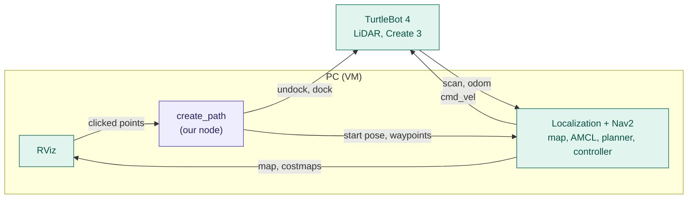

# day8pkg

Python package for CS 5335 Project 8 (TurtleBot 4 and Nav2 tutorials). The demo is the
TurtleBot 4 Navigator's
[Create Path](https://turtlebot.github.io/turtlebot4-user-manual/tutorials/turtlebot4_navigator.html#create-path):
you click a few points in RViz, and the real robot drives through them with Nav2 on a map of
the room. It needs no simulator (Gazebo). The assignment asks for a path with at least two
segments of about 1 m with an angle between them, for example an L.

Everything runs on the PC (the VM): localization, Nav2, RViz and `create_path`. Use four
terminals, each with the [PC terminal settings](#pc-terminal-settings):

| Terminal | Runs |
| -------- | ---- |
| T1 | Localization |
| T2 | RViz |
| T3 | Nav2 |
| T4 | Undock, dock, `activate_nav.bash`, `create_path` (in `robotics_ws`, after `source install/setup.bash`) |

The first time, do the [one-time setup](#one-time-setup) first.

## Demo

### Before the instructor watches: start localization and Nav2

Nav2 can only finish starting while the robot is off the dock, so start it first, as its own
step. Once it is active, it stays active when the robot docks again.

1. Put the robot on the dock.
2. **T1**, localization with the map:

   ```bash
   ros2 launch turtlebot4_navigation localization.launch.py map:=$HOME/lab_map.yaml
   ```

3. **T2**, RViz (only one). Wait until the map shows.

   ```bash
   ros2 launch turtlebot4_viz view_navigation.launch.py
   ```

4. **T4**, undock:

   ```bash
   ros2 action send_goal /undock irobot_create_msgs/action/Undock "{}"
   ```

5. In RViz, click **2D Pose Estimate** and drag an arrow where the robot is, pointing the way its
   camera side faces, until the red LiDAR points lie on the black walls.
6. **T3**, Nav2, saving its output to `~/nav2.log`:

   ```bash
   ros2 launch turtlebot4_navigation nav2.launch.py 2>&1 | tee ~/nav2.log
   ```

7. **T4**, wait about 30 s, then make sure every node is active:

   ```bash
   bash src/day8pkg/scripts/activate_nav.bash
   ```

   On this network an answer between two nodes sometimes gets lost while they start, which
   leaves a node half-started and everything after it waiting. The script asks each node in
   turn and pushes it on until it is active. It ends with `All nodes active`; if everything was
   already active, that takes a few seconds. If one node keeps printing `no answer`, see
   [The activation script does not finish](#the-activation-script-does-not-finish).
8. **T4**, dock again:

   ```bash
   ros2 action send_goal /dock irobot_create_msgs/action/Dock "{}"
   ```

Leave T1, T2 and T3 running.

### The demo

Clear the floor, keep people away from the path and have someone ready to pick the robot up.
Plan the path first: for example A → B is 1 m straight, B → C is 1 m after a 90° turn. In RViz
one grid cell is 1 m. Pick points in open space, away from table legs.

1. **T4**, start `create_path` with the dock's pose:

   ```bash
   ros2 run day8pkg create_path --ros-args --params-file src/day8pkg/config/lab_dock.yaml
   ```

2. In RViz, click **2D Pose Estimate** and drag at A with the arrow toward B, then at B toward
   C, then at C. Each click prints `Pose n added: (x, y)` in T4. The robot icon jumps to each
   click; that is expected.
3. Press **Enter** in T4. It prints the points (show that A → B and B → C are about 1 m), resets
   the pose to the dock, undocks, checks that Nav2 is active, and drives A → B → C, then docks.

To stop the robot at any time, press Ctrl-C in T4, or pick it up.

## One-time setup

Do these once, in this order. Redo A only if the room changes a lot, and B whenever the dock
moves or you make a new map. Mark the dock's place on the floor with tape so it always goes back
to the same spot.

### PC terminal settings

**Every terminal** must have exactly the same settings, or nodes find each other slowly and
answers get lost. This robot uses a discovery server on the robot (`10.245.131.96` is its IP;
change it if it changes). Run this in every terminal, and do **not** use `ROS_DOMAIN_ID=8` from
the workspace Setup for this project:

```bash
source /opt/ros/jazzy/setup.bash
export RMW_IMPLEMENTATION=rmw_fastrtps_cpp
export ROS_DOMAIN_ID=0
export ROS_DISCOVERY_SERVER=";;;;;;;;10.245.131.96:11811;"
export ROS_SUPER_CLIENT=True
export FASTDDS_BUILTIN_TRANSPORTS=UDPv4
```

To check a terminal (the output must be the same in every terminal):

```bash
printenv | grep -E "ROS_DOMAIN_ID|RMW_IMPLEMENTATION|ROS_DISCOVERY_SERVER|ROS_SUPER_CLIENT|FASTDDS"
```

After changing settings, restart the ROS daemon once: `ros2 daemon stop; ros2 daemon start`.

Get the latest code and build it, in the repository:

```bash
git pull
cd robotics_ws
colcon build --packages-select day8pkg
source install/setup.bash
```

Check that no node runs twice (it must print nothing but a warning line):

```bash
ros2 node list | sort | uniq -d
```

If it lists nodes, close extra RViz windows and leftover terminals. If robot nodes such as
`/turtlebot4_node` are listed, reboot the robot (`ssh ubuntu@10.245.131.96`, then
`sudo reboot`, and wait 2 minutes).

### A. Map the room

1. Put the robot on the dock. Start SLAM and RViz, each in its own terminal:

   ```bash
   ros2 launch turtlebot4_navigation slam.launch.py
   ```

   ```bash
   ros2 launch turtlebot4_viz view_navigation.launch.py
   ```

2. Undock (`ros2 action send_goal /undock irobot_create_msgs/action/Undock "{}"`).
3. Drive slowly around the room with the keyboard, watching the map fill in RViz. Keep people
   out of the area while mapping.

   ```bash
   ros2 run teleop_twist_keyboard teleop_twist_keyboard --ros-args -p stamped:=true
   ```

   Keys (keep this terminal focused): `i` forward, `,` backward, `j` / `l` turn left / right,
   `k` stop, `z` slower. Press `z` about 9 times first, to about 0.2 m/s; slow turns keep the
   map sharp.
4. Save the map **while SLAM is still running** (it keeps the map only in memory). In your home
   directory, this writes `lab_map.pgm` and `lab_map.yaml` there:

   ```bash
   ros2 service call /slam_toolbox/save_map slam_toolbox/srv/SaveMap "name:
     data: 'lab_map'"
   ```

5. Stop SLAM with Ctrl-C and drive the robot back onto the dock.

### B. Measure the dock's pose

`create_path` needs the robot's pose **while it is on the dock**, in the map's coordinates. The
robot cannot measure it on the dock, because the LiDAR is off there (power saver). So measure it
just outside the dock, then drive back on while recording.

1. With the robot on the dock, start localization (T1) and RViz (T2), as in the
   [demo](#before-the-instructor-watches-start-localization-and-nav2) steps 2 and 3.
2. **T4**, undock, so that the LiDAR turns on.
3. In RViz, click **2D Pose Estimate** and drag an arrow where the robot is, pointing the way its
   **camera side** faces. Repeat until the red LiDAR points lie on the black walls, including
   their tilt. The room is nearly a rectangle, so an arrow pointing the wrong way (180°) can also
   put the points on the walls: check that the box near the top wall and the openings line up
   too.
4. With teleop, turn slowly about a quarter turn with `j`, back with `l`, then `k`. The red points
   should stay on the walls.
5. **T3**, start printing the robot's pose on the map, and **leave it running**:

   ```bash
   ros2 run tf2_ros tf2_echo map base_link
   ```

6. **T4**, dock (`ros2 action send_goal /dock irobot_create_msgs/action/Dock "{}"`).
7. Once docked, `tf2_echo` soon starts printing `Lookup would require extrapolation into the
   past`. The **last pose before those warnings** is the dock's. Take `Translation` x and y, and
   the last number of `Rotation: in RPY (degree)`.
8. Write them into `config/lab_dock.yaml`, each with a decimal point (`-6.4`, not `-6`). The
   current values:

   ```yaml
   /**:
     ros__parameters:
       dock_x: 0.129 # m
       dock_y: 0.04 # m
       dock_yaw_deg: 173.6 # -6.4 + 180
   ```

   `create_path` reads this file from `src`, so changing it needs no rebuild.
9. Stop everything with Ctrl-C.

## Troubleshooting

### The activation script does not finish

It keeps printing the same node with `no answer`, or with a state that does not change.

1. Find the reason in the logs. For `map_server` or `amcl` look at T1, for the other nodes:

   ```bash
   grep -n -E "Managed nodes|Activating|Aborting|died|ERROR|Timed out" ~/nav2.log | tail -20
   ```

   - `map_server` stays `unconfigured`: the map file cannot be read. Check the path in T1.
   - `Timed out waiting for transform` (often at `controller_server` or `planner_server`): AMCL
     has no pose. Check that the robot is off the dock and set its pose with 2D Pose Estimate.
   - `process has died`, or one node never answers: that node is stuck or gone.
2. Stop the script with Ctrl-C and restart Nav2 cleanly: Ctrl-C in T3, check that no Nav2
   process is left (`kill` any that is, with the number in the second column), start Nav2 again
   (demo step 6) and run the script again.

   ```bash
   ps aux | grep -E "controller_server|planner_server|collision_monitor|bt_navigator|waypoint_follower|lifecycle_manager" | grep -v grep
   ```

### Other problems

| What you see | Why | What to do |
| ------------ | --- | ---------- |
| RViz shows no map | Localization in T1 has not finished starting | Run `activate_nav.bash` (it starts `map_server` and `amcl` too), then untick and tick the Map display in RViz |
| `create_path` keeps printing `Waiting for AMCL to report a pose...` or `... is inactive, waiting...` | Localization or Nav2 is half-started | Run `activate_nav.bash` in another terminal. **The robot starts driving as soon as it succeeds** |
| After the undock, the red points do not lie on the walls | `lab_dock.yaml` is wrong, or the dock moved | Redo [B](#b-measure-the-docks-pose). `create_path` gives AMCL the dock pose as certain, so AMCL does not correct a wrong one |
| The red points lie on the walls, but the robot icon faces the opposite way from the real robot (camera side) | The dock's yaw is 180° off | Add or subtract 180 in `dock_yaw_deg`, or redo [B](#b-measure-the-docks-pose) |
| `ros2 node list \| sort \| uniq -d` lists nodes | Two RViz, a leftover terminal, or the robot's software running twice | See [PC terminal settings](#pc-terminal-settings) |
| RViz prints `Waiting for the slam_toolbox node configuration` | Its SLAM panel looks for SLAM, which is not running | Nothing |
| RViz prints `Message Filter dropping message ... queue is full` | RViz cannot place the LiDAR points on the map in time, usually because AMCL is not running yet | A few lines are fine; otherwise run `activate_nav.bash` |
| Nav2 keeps printing `Message Filter dropping message ... earlier than all the data in the transform cache` | The robot's two computers (Raspberry Pi and Create 3) disagree on the time | A few lines while Nav2 starts are fine. If it never stops, power the robot fully off and on: take it off the dock, hold the power button about 10 s until the lights go out, put it back on the dock, wait 2-3 minutes |
| `tf2_echo` only prints `extrapolation into the past`, never a pose | It was started after docking, when the LiDAR was already off | Start it before docking (B step 5) |
| A `ros2` command hangs with no output | Its answer got lost | Ctrl-C and run it again; put `timeout -k 3 10` in front of it |
| `ros2 run day8pkg ...` is not found | Not built, or `install/setup.bash` not sourced | See [PC terminal settings](#pc-terminal-settings) |

## How it works

### The idea in short

Up to Project 7 our own nodes sent `cmd_vel`. Here Nav2 drives: AMCL finds the robot on the
map, the planner plans a path and the controller sends `cmd_vel`. Our node only says **where
to go**, like telling a taxi driver the stops.

```text
create_path:
    collect the points clicked in RViz (2D Pose Estimate) until Enter
    dock if needed; tell AMCL the robot is at the dock (pose from config/lab_dock.yaml)
    undock; wait until AMCL reports a pose and Nav2 is active
    drive through the points with Nav2, then dock
```



Clicking with 2D Pose Estimate also moves AMCL's estimate, so `create_path` needs a known place
to reset the robot's pose to afterwards: the dock. That is why the dock's pose on the map is
measured once and kept in `config/lab_dock.yaml`.

### Why the activation script

Localization and Nav2 are not one program each but chains of nodes (map server, AMCL, planner,
controller, velocity smoother, collision monitor, waypoint follower, ...). A lifecycle manager
starts them one by one, asking each "are you ready?" and waiting for the answer, and the robot
can only move once **all** of them are active. Nodes find each other through the discovery
server on the robot, and while they start, it is often too slow to introduce a new node before
the first answer is sent, so that answer is lost. The lifecycle manager then waits forever and
the nodes after it never start. This happens on the PC and on the robot alike, whatever the
start order. `activate_nav.bash` does the lifecycle manager's job again, asking each node itself
and retrying until it is active. `create_path` likewise asks again when an answer is lost.

### Files

| File | What it is |
| ---- | ---------- |
| `day8pkg/create_path.py` | Node for the demo: Create Path, points clicked with 2D Pose Estimate |
| `day8pkg/point_path.py` | Other node: path from points clicked with Publish Point |
| `config/lab_dock.yaml` | The dock's pose on the lab map, for `create_path` |
| `scripts/activate_nav.bash` | Brings localization and Nav2 to active, retrying lost answers |
| `scripts/sim*.bash`, `scripts/query_dock.bash` | The course's simulator launchers and dock query, for the [simulator](#in-the-simulator-optional) |

## Extra credit: lab map

The map from [A](#a-map-the-room) counts if it covers at least half of the room. Show the
instructor `lab_map.pgm` (or the map in RViz), then drive through the room with the demo above.

## Other ways to drive

- **Nav2 Goal**: with localization and Nav2 running and the robot undocked, set the pose with
  **2D Pose Estimate**, then click a goal with **Nav2 Goal**.
- **`point_path`**: the same as `create_path`, but you click the points with **Publish Point**,
  which does not move AMCL's pose, so it needs no `lab_dock.yaml`. Undock, set the pose with
  **2D Pose Estimate**, run `ros2 run day8pkg point_path`, click the points and press Enter.
  Each click prints its distance from the previous point.

## In the simulator (optional)

The simulator needs Gazebo and a computer with a GPU; it does not run in a virtual machine (the
robot never spawns there). It also uses no discovery server: unset `ROS_DISCOVERY_SERVER` and
`ROS_SUPER_CLIENT` in its terminals. From `robotics_ws`:

```bash
bash src/day8pkg/scripts/sim.bash
```

This one command starts Gazebo, localization, Nav2 and RViz. In the simulator the dock is at the
map origin, so run `ros2 run day8pkg create_path` with no parameters and follow
[the demo](#the-demo) from step 2. Stop the simulator with Ctrl-C in its terminal, not by
closing its windows.
