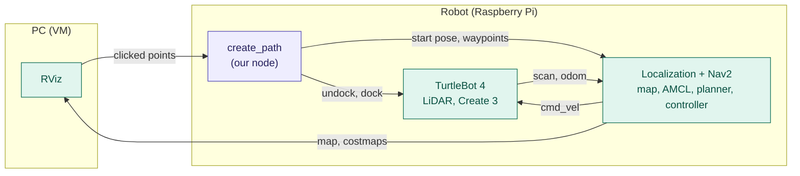

# day8pkg

Python package for CS 5335 Project 8 (TurtleBot 4 and Nav2 tutorials). The demo is the
TurtleBot 4 Navigator's
[Create Path](https://turtlebot.github.io/turtlebot4-user-manual/tutorials/turtlebot4_navigator.html#create-path):
you click a few points in RViz, and the real robot drives through them with Nav2 on a map of
the room. It needs no simulator (Gazebo). The assignment asks for a path with at least two
segments of about 1 m with an angle between them, for example an L.

**Everything except RViz runs on the robot**: localization, Nav2 and `create_path`. The PC only
shows RViz, where you click. See [Why on the robot](#why-on-the-robot) for the reason.

| Terminal | Where | Runs |
| -------- | ----- | ---- |
| Robot A | PC terminal, logged in with `ssh ubuntu@10.245.131.96` | Localization |
| Robot B | same | Nav2 |
| Robot C | same | Undock, dock, `create_path` |
| PC 1 | PC terminal with the [PC settings](#pc-terminal-settings) | RViz |

`10.245.131.96` is the robot's IP; change it everywhere if it changes. The first time, do the
[one-time setup](#one-time-setup) first.

## Demo

### Before the instructor watches: start Nav2

Nav2 can only finish starting while the robot is off the dock, so start it first, as its own
step. Once it is running, it stays running when the robot docks again.

1. Put the robot on the dock.
2. **Robot A**, localization with the map:

   ```bash
   ros2 launch turtlebot4_navigation localization.launch.py map:=/home/ubuntu/lab_map.yaml
   ```

3. **PC 1**, RViz (only one). Wait until the map shows.

   ```bash
   ros2 launch turtlebot4_viz view_navigation.launch.py
   ```

4. **Robot C**, undock:

   ```bash
   ros2 action send_goal /undock irobot_create_msgs/action/Undock "{}"
   ```

5. In RViz, click **2D Pose Estimate** and drag an arrow where the robot is, pointing the way its
   camera side faces, until the red LiDAR points lie on the black walls.
6. **Robot B**, Nav2, saving its output to `~/nav2.log`:

   ```bash
   ros2 launch turtlebot4_navigation nav2.launch.py 2>&1 | tee ~/nav2.log
   ```

   Wait for `Managed nodes are active`. If it does not come within two minutes, see
   [Nav2 does not finish starting](#nav2-does-not-finish-starting).
7. **Robot C**, dock again:

   ```bash
   ros2 action send_goal /dock irobot_create_msgs/action/Dock "{}"
   ```

Leave Robot A, Robot B and PC 1 running.

### The demo

Clear the floor, keep people away from the path and have someone ready to pick the robot up.
Plan the path first: for example A → B is 1 m straight, B → C is 1 m after a 90° turn. In RViz
one grid cell is 1 m. Pick points in open space, away from table legs.

1. **Robot C**, start `create_path` with the dock's pose:

   ```bash
   python3 ~/day8pkg/day8pkg/create_path.py --ros-args --params-file ~/day8pkg/config/lab_dock.yaml
   ```

2. In RViz, click **2D Pose Estimate** and drag at A with the arrow toward B, then at B toward
   C, then at C. Each click prints `Pose n added: (x, y)` in Robot C. The robot icon jumps to
   each click; that is expected.
3. Press **Enter** in Robot C. It prints the points (show that A → B and B → C are about 1 m),
   resets the pose to the dock, undocks, checks that Nav2 is active, and drives A → B → C, then
   docks.

To stop the robot at any time, press Ctrl-C in Robot C, or pick it up.

## One-time setup

Do these once, in this order. Redo A only if the room changes a lot, B whenever the code
changes, and C whenever the dock moves or you make a new map. Mark the dock's place on the floor
with tape so it always goes back to the same spot.

### PC terminal settings

**Every PC terminal** must have exactly the same settings, or nodes find each other slowly and
answers get lost. This robot uses a discovery server on the robot. Run this in every PC terminal,
and do **not** use `ROS_DOMAIN_ID=8` from the workspace Setup for this project:

```bash
source /opt/ros/jazzy/setup.bash
export RMW_IMPLEMENTATION=rmw_fastrtps_cpp
export ROS_DOMAIN_ID=0
export ROS_DISCOVERY_SERVER=";;;;;;;;10.245.131.96:11811;"
export ROS_SUPER_CLIENT=True
export FASTDDS_BUILTIN_TRANSPORTS=UDPv4
```

Robot terminals need nothing: the robot sets up ROS by itself, so do not run these there. After
changing settings on the PC, restart the ROS daemon once: `ros2 daemon stop; ros2 daemon start`.

Check that no node runs twice (in a PC terminal; it must print nothing but a warning line):

```bash
ros2 node list | sort | uniq -d
```

If it lists nodes, close extra RViz windows and leftover terminals, and stop any localization or
Nav2 running on the PC. If robot nodes such as `/turtlebot4_node` are listed, reboot the robot
(Robot terminal: `sudo reboot`, then wait 2 minutes).

### A. Map the room

1. Put the robot on the dock. In PC terminals, start SLAM and RViz:

   ```bash
   ros2 launch turtlebot4_navigation slam.launch.py
   ```

   ```bash
   ros2 launch turtlebot4_viz view_navigation.launch.py
   ```

2. **Robot C**, undock (`ros2 action send_goal /undock irobot_create_msgs/action/Undock "{}"`).
3. Drive slowly around the room with the keyboard (Robot C), watching the map fill in RViz. Keep
   people out of the area while mapping.

   ```bash
   ros2 run teleop_twist_keyboard teleop_twist_keyboard --ros-args -p stamped:=true
   ```

   Keys (keep this terminal focused): `i` forward, `,` backward, `j` / `l` turn left / right,
   `k` stop, `z` slower. Press `z` about 9 times first, to about 0.2 m/s; slow turns keep the
   map sharp.
4. Save the map **while SLAM is still running** (it keeps the map only in memory). In a PC
   terminal in your home directory, this writes `lab_map.pgm` and `lab_map.yaml` there:

   ```bash
   ros2 service call /slam_toolbox/save_map slam_toolbox/srv/SaveMap "name:
     data: 'lab_map'"
   ```

5. Stop SLAM with Ctrl-C and drive the robot back onto the dock.
6. Copy the map to the robot (PC terminal; it asks for the robot's password):

   ```bash
   scp ~/lab_map.pgm ~/lab_map.yaml ubuntu@10.245.131.96:~/
   ```

### B. Copy day8pkg to the robot

`create_path` runs on the robot straight from its source with `python3`, so nothing needs to be
built there. In a PC terminal, get the latest code and copy the package over:

```bash
cd ~/Robotics && git pull
scp -r ~/Robotics/robotics_ws/src/day8pkg ubuntu@10.245.131.96:~/
```

This puts it at `~/day8pkg` on the robot. Copy it again after every code change.

### C. Measure the dock's pose

`create_path` needs the robot's pose **while it is on the dock**, in the map's coordinates. The
robot cannot measure it on the dock, because the LiDAR is off there (power saver). So measure it
just outside the dock, then drive back on while recording.

1. With the robot on the dock, start localization (Robot A) and RViz (PC 1), as in the
   [demo](#before-the-instructor-watches-start-nav2) steps 2 and 3.
2. **Robot C**, undock, so that the LiDAR turns on.
3. In RViz, click **2D Pose Estimate** and drag an arrow where the robot is, pointing the way its
   **camera side** faces. Repeat until the red LiDAR points lie on the black walls, including
   their tilt. The room is nearly a rectangle, so an arrow pointing the wrong way (180°) can also
   put the points on the walls: check that the box near the top wall and the openings line up
   too.
4. With teleop (Robot C), turn slowly about a quarter turn with `j`, back with `l`, then `k`. The
   red points should stay on the walls.
5. **Robot B**, start printing the robot's pose on the map, and **leave it running**:

   ```bash
   ros2 run tf2_ros tf2_echo map base_link
   ```

6. **Robot C**, dock (`ros2 action send_goal /dock irobot_create_msgs/action/Dock "{}"`).
7. Once docked, `tf2_echo` soon starts printing `Lookup would require extrapolation into the
   past`. The **last pose before those warnings** is the dock's. Take `Translation` x and y, and
   the last number of `Rotation: in RPY (degree)`.
8. **Robot C**, write them into the robot's copy, each with a decimal point (`-6.4`, not `-6`):

   ```bash
   nano ~/day8pkg/config/lab_dock.yaml
   ```

   ```yaml
   /**:
     ros__parameters:
       dock_x: 0.129       # m
       dock_y: 0.04        # m
       dock_yaw_deg: -6.4  # deg
   ```

   Ctrl-O saves, Ctrl-X quits. Put the same numbers into `robotics_ws/src/day8pkg/config/lab_dock.yaml`
   on the PC too, so that copying the package again (B) does not undo them.
9. Stop everything with Ctrl-C.

## Troubleshooting

### Nav2 does not finish starting

`Managed nodes are active` never comes, or `create_path` keeps printing
`... is inactive, waiting...`. Run these in a robot terminal.

1. Is AMCL publishing the robot's pose on the map? This must print a pose about every second,
   with `At time` going up:

   ```bash
   timeout -k 3 15 ros2 run tf2_ros tf2_echo map odom
   ```

   If it does not, Nav2 cannot start either: check that the robot is off the dock and set its
   pose with 2D Pose Estimate.
2. See which node Nav2 stopped at. It starts them in this order, and the first one that is not
   `active [3]` is where it hangs:

   ```bash
   for n in controller_server smoother_server planner_server behavior_server velocity_smoother collision_monitor bt_navigator waypoint_follower docking_server; do echo -n "$n: "; timeout -k 3 10 ros2 lifecycle get /$n || echo "(no answer)"; done
   ```

3. Look for the reason in the log:

   ```bash
   grep -n -E "Managed nodes|Activating|Aborting|failed to send|died|ERROR|Timed out" ~/nav2.log | tail -20
   ```

   - The last `Activating ...` is recent: it is still starting (the Raspberry Pi is slow). Wait.
   - `Timed out waiting for transform`: AMCL has no pose (see 1).
   - `process has died`, or one node never answers: that node is stuck or gone. Restart Nav2
     (4).
4. Restart Nav2 cleanly: Ctrl-C in Robot B, check that no Nav2 process is left (`kill` any that
   is, with the number in the second column), then start it again with the robot off the dock
   and its pose set.

   ```bash
   ps aux | grep -E "controller_server|planner_server|collision_monitor|bt_navigator|waypoint_follower|lifecycle_manager" | grep -v grep
   ```

5. If some nodes stay `inactive [2]` while the log does not move, activate them by hand. This
   loop retries each one until it is active. **If `create_path` is waiting, the robot starts
   driving as soon as this succeeds.**

   ```bash
   for n in smoother_server planner_server behavior_server velocity_smoother collision_monitor bt_navigator waypoint_follower docking_server; do until timeout -k 3 10 ros2 lifecycle get /$n 2>/dev/null | grep -q "active \[3\]"; do echo "== activating $n"; timeout -k 3 15 ros2 lifecycle set /$n activate; done; echo "$n: active"; done
   ```

   Ctrl-C stops it, for example if one node never comes up; then restart Nav2 (4).

### Other problems

| What you see | Why | What to do |
| ------------ | --- | ---------- |
| After the undock, the red points do not lie on the walls | `lab_dock.yaml` is wrong, or the dock moved | Redo [C](#c-measure-the-docks-pose). `create_path` gives AMCL the dock pose as certain, so AMCL does not correct a wrong one |
| The red points lie on the walls, but the robot icon faces the opposite way from the real robot (camera side) | The dock's yaw is 180° off | Add 180 to `dock_yaw_deg` (for example `-6.4` → `173.6`), or redo [C](#c-measure-the-docks-pose) |
| `ros2 node list \| sort \| uniq -d` lists nodes | Two RViz, a leftover terminal, localization or Nav2 running on both the PC and the robot, or the robot's software running twice | See [PC terminal settings](#pc-terminal-settings) |
| RViz prints `Waiting for the slam_toolbox node configuration` | Its SLAM panel looks for SLAM, which is not running | Nothing |
| RViz prints `Message Filter dropping message ... queue is full` | RViz cannot place the LiDAR points on the map in time, usually because AMCL's `map` → `odom` is late or missing | Check Nav2 step 1 above. A few lines are fine |
| Nav2 prints `Control loop missed its desired rate` | The Raspberry Pi is busy | Fine for the demo; the robot may move less smoothly |
| Nav2 keeps printing `Message Filter dropping message ... earlier than all the data in the transform cache` | The robot's two computers (Raspberry Pi and Create 3) disagree on the time | A few lines while Nav2 starts are fine. If it never stops, power the robot fully off and on: take it off the dock, hold the power button about 10 s until the lights go out, put it back on the dock, wait 2-3 minutes |
| `Package 'turtlebot4_navigation' not found`, or `No module named 'turtlebot4_navigation'`, in a robot terminal | The robot's software lacks it | Ask the TA |
| `tf2_echo` only prints `extrapolation into the past`, never a pose | It was started after docking, when the LiDAR was already off | Start it before docking (C step 5) |
| A `ros2` command hangs with no output | Its answer got lost | Ctrl-C and run it again; put `timeout -k 3 10` in front of it |

## How it works

### The idea in short

Up to Project 7 our own nodes sent `cmd_vel`. Here Nav2 drives: AMCL finds the robot on the
map, the planner plans a path and the controller sends `cmd_vel`. Our node only says **where
to go**, like telling a taxi driver the stops.

```text
create_path:
    collect the points clicked in RViz (2D Pose Estimate) until Enter
    dock if needed; tell AMCL the robot is at the dock (pose from config/lab_dock.yaml)
    undock; wait until AMCL reports a pose and Nav2 is active
    drive through the points with Nav2, then dock
```



Clicking with 2D Pose Estimate also moves AMCL's estimate, so `create_path` needs a known place
to reset the robot's pose to afterwards: the dock. That is why the dock's pose on the map is
measured once and kept in `config/lab_dock.yaml`.

### Why on the robot

Nav2 is not one program but a chain of nodes (planner, controller, velocity smoother, collision
monitor, waypoint follower, ...). A lifecycle manager starts them one by one, asking each "are
you ready?", and the robot can only move once **all** of them are active. `create_path` also
keeps asking: "undock", "is Nav2 active?", "follow these points". Nodes find each other through
the discovery server, which runs on the robot. When such questions and answers cross Wi-Fi to
the PC, answers get lost and things hang. On the robot, they all stay on one machine. RViz only
shows pictures and sends your clicks, one-way messages that cope with Wi-Fi. The tutorial allows
this ("start Navigation on your PC or the Raspberry Pi").

Nav2 can finish starting only while AMCL publishes the robot's pose, which needs the LiDAR, so
the robot must be off the dock then. Once active, Nav2 stays active, also after the robot docks
again.

### Files

| File | What it is |
| ---- | ---------- |
| `day8pkg/create_path.py` | Node for the demo: Create Path, points clicked with 2D Pose Estimate |
| `day8pkg/point_path.py` | Other node: path from points clicked with Publish Point |
| `config/lab_dock.yaml` | The dock's pose on the lab map, for `create_path` |
| `scripts/` | The course's simulator launchers and dock query, for the [simulator](#in-the-simulator-optional) |

## Extra credit: lab map

The map from [A](#a-map-the-room) counts if it covers at least half of the room. Show the
instructor `lab_map.pgm` (or the map in RViz), then drive through the room with the demo above.

## Other ways to drive

- **Nav2 Goal**: with localization and Nav2 running and the robot undocked, set the pose with
  **2D Pose Estimate**, then click a goal with **Nav2 Goal**.
- **`point_path`**: the same as `create_path`, but you click the points with **Publish Point**,
  which does not move AMCL's pose, so it needs no `lab_dock.yaml`. Undock, set the pose with
  **2D Pose Estimate**, run `python3 ~/day8pkg/day8pkg/point_path.py` in Robot C, click the
  points and press Enter. Each click prints its distance from the previous point.
- On the PC, after `colcon build --packages-select day8pkg` and `source install/setup.bash` in
  `robotics_ws`, both also run as `ros2 run day8pkg create_path` and `ros2 run day8pkg point_path`,
  but their questions to Nav2 then cross Wi-Fi.

## In the simulator (optional)

The simulator needs Gazebo and a computer with a GPU; it does not run in a virtual machine (the
robot never spawns there). It also uses no discovery server: unset `ROS_DISCOVERY_SERVER` and
`ROS_SUPER_CLIENT` in its terminals. From `robotics_ws`:

```bash
bash src/day8pkg/scripts/sim.bash
```

This one command starts Gazebo, localization, Nav2 and RViz. In the simulator the dock is at the
map origin, so run `ros2 run day8pkg create_path` with no parameters and follow
[the demo](#the-demo) from step 2. Stop the simulator with Ctrl-C in its terminal, not by
closing its windows.
