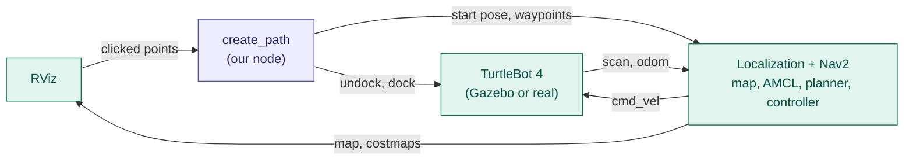

# day8pkg

Python package for CS 5335 Project 8 (TurtleBot 4 and Nav2 tutorials). The demo is the
TurtleBot 4 Navigator's
[Create Path](https://turtlebot.github.io/turtlebot4-user-manual/tutorials/turtlebot4_navigator.html#create-path):
you click a few points in RViz, and the robot drives through them with Nav2. The assignment
asks for a path with at least two segments of about 1 m with an angle between them, for example
an L.

- **[Demo in the simulator](#demo-in-the-simulator)** (the required demo): Gazebo, on a computer
  with a GPU. Not in a virtual machine.
- **[Extra credit: the real robot](#extra-credit-the-real-robot)**: your own lab map and the real
  TurtleBot 4.

Ask the instructor if unsure which one the demo needs.

## Demo in the simulator

Gazebo plays the robot and the room (the course's warehouse world, with its map). It needs a
computer with a GPU; it does not work in a virtual machine. Use two terminals:

| Terminal | Runs |
| -------- | ---- |
| T1 | The simulator: Gazebo, localization, Nav2 and RViz, all started by `sim.bash` |
| T2 | `create_path`, and the checks in [Debugging](#debugging-in-the-simulator) |

The robot starts on its dock, which in this world is at the map origin, so `create_path` needs
no `lab_dock.yaml` here. You do not need to undock by hand.

### 1. Prepare the computer (once per computer)

1. Check that ROS 2 Jazzy and the TurtleBot 4 packages are installed:

   ```bash
   source /opt/ros/jazzy/setup.bash
   ros2 pkg list | grep -E "^turtlebot4_(gz_bringup|navigation|viz)$"
   ```

   All three names must print. If one is missing, install them (this needs `sudo`; on a lab
   computer, ask the TA):

   ```bash
   sudo apt update
   sudo apt install ros-jazzy-turtlebot4-simulator ros-jazzy-turtlebot4-desktop ros-jazzy-turtlebot4-navigation
   ```

2. Get the code. If `~/Robotics` does not exist on this computer yet, clone it first:

   ```bash
   cd ~ && git clone https://github.com/Happy1HappyHappy/Robotics.git
   ```

   Then update and build it:

   ```bash
   cd ~/Robotics && git pull
   cd robotics_ws
   colcon build --packages-select day8pkg
   ```

   The build must end with `Summary: 1 package finished`. If T1 or T2 was already open, run
   step 2.1 in it again afterwards, so that it finds the new build.

### 2. Set up both terminals (every time)

1. Open T1 and T2. In **each** one, run this exact line (the file is in
   `robotics_ws/src/day8pkg/scripts`, not in `~/Robotics`):

   ```bash
   source ~/Robotics/robotics_ws/src/day8pkg/scripts/sim_env.bash
   ```

   It must print `Simulator settings: ROS_DOMAIN_ID=73`. If it prints `No such file or directory`
   instead, nothing was set: fix the path and run it again. It switches off the real robot's
   discovery server (which your `.bashrc` may set), puts the terminal on the simulator's ROS
   network, and loads the built `day8pkg`. A terminal without it can neither see the simulator
   nor find `day8pkg`. To check a terminal at any time (it must print `73`):

   ```bash
   printenv ROS_DOMAIN_ID
   ```

2. In T1, stop anything left from an earlier run. Do this before **every** start: a second run
   that collides with leftovers from the first one fails (no map, `Waiting for service ...`
   forever, a slow Gazebo). It stops every ROS 2 program on this computer, restarts the ROS
   daemon with these settings, and ends with `All clean`:

   ```bash
   bash ~/Robotics/robotics_ws/src/day8pkg/scripts/sim_reset.bash
   ```

### 3. Start the simulator (T1)

This also saves everything T1 prints to `~/sim.log`, for [Debugging](#debugging-in-the-simulator):

```bash
cd ~/Robotics/robotics_ws
bash src/day8pkg/scripts/sim.bash 2>&1 | tee ~/sim.log
```

Give it one or two minutes, then check:

- The Gazebo window shows the warehouse **with the robot on its dock**. If Gazebo is paused, press
  ▶ (bottom left).
- RViz shows the map of the warehouse and the robot.

T1 keeps printing `Waiting for the slam_toolbox node configuration`. That comes from an RViz panel
for mapping, which this demo does not use: ignore it.

### 4. Set the start pose (RViz)

1. In RViz, click **2D Pose Estimate**, press on the robot (at the middle of the grid) and drag
   in the direction it faces.
2. Within about 30 s the **costmaps** appear: colored bands along the walls, and red LiDAR points
   on the walls. This means Nav2 has finished starting.

If no costmap appears after a minute, run this in T2 and wait for `All nodes active`:

```bash
bash ~/Robotics/robotics_ws/src/day8pkg/scripts/activate_nav.bash
```

### 5. Start create_path (T2)

1. Check that T2 is on the simulator's ROS network: `printenv ROS_DOMAIN_ID` must print `73`. If
   it does not, run step 2.1 in T2.
2. Turn off the collision monitor's approach check. In this simulator it sees something inside
   the robot's outline and stops every move, so the robot undocks and then stays where it is
   while T1 keeps printing `Robot to approach for 1.200000 seconds away from collision`. Do this
   after **every** start of the simulator, since a restart turns it on again:

   ```bash
   ros2 param set /collision_monitor FootprintApproach.enabled false
   ros2 param get /collision_monitor FootprintApproach.enabled
   ```

   The first must print `Set parameter successful`, the second `Boolean value is: False`. This
   is only for the simulator; on the real robot, keep it on.
3. Start `create_path`:

   ```bash
   cd ~/Robotics/robotics_ws
   ros2 run day8pkg create_path
   ```

   It prints `Click poses with "2D Pose Estimate" in RViz, then press Enter here.` Wait about
   10 s before clicking, so that it is connected to RViz.

### 6. Click the path and run it

1. Plan an L in **open space**: A → B is 1 m straight, B → C is 1 m after a 90° turn. One RViz
   grid cell is 1 m. Keep every point at least one cell away from the colored bands.
2. In RViz, click **2D Pose Estimate** and drag at A with the arrow toward B. T2 prints
   `Pose 1 added: (x, y)`. Do the same at B (arrow toward C) and at C. The robot icon jumps to
   each click; that is expected, and `create_path` puts it back later.
3. Show the instructor the three `Pose n added` lines: A → B and B → C are about 1 m, in
   different directions.
4. Press **Enter** in T2. It resets the robot's pose to the dock, undocks, waits for Nav2
   (`... is active`), prints `Following waypoints...`, and the robot drives A → B → C in Gazebo
   and RViz, then docks.

### 7. Stop, or start over

Press Ctrl-C in T2, then in T1, then run `sim_reset.bash` (step 2.2) so that nothing is left. To
start over at any point, do the same and go back to [step 3](#3-start-the-simulator-t1).

## Debugging in the simulator

### Where to look

- **RViz, Navigation 2 panel** (left): `Navigation` and `Localization` must say `active`. While
  the robot drives, `Distance remaining` goes down. If it stays the same while `Recoveries` goes
  up, Nav2 is stuck: each recovery (clear the costmaps, spin, wait, back up) is a new try that
  failed again.
- **The log**: everything T1 printed is in `~/sim.log` (step 3). Search it in T2, leaving out the
  `slam_toolbox` noise:

  ```bash
  grep -v slam_toolbox ~/sim.log | grep -E "Robot to stop|Robot to approach|Failed|No valid|lethal|died|ERROR" | tail -30
  ```

  If T1 was started without `tee`, search T1 itself: click the magnifier in its title bar (or
  press Ctrl+Shift+F) and type the words, for example `Robot to stop`.
- **Live checks** with `ros2` commands: run them in a terminal where `printenv ROS_DOMAIN_ID`
  prints `73`, or they see nothing.

### The robot does not move

Nav2 is active and has a path (`Distance remaining` is not 0), but the robot does not move. A
velocity command goes through three topics before it reaches the robot:

```text
controller ──► /cmd_vel_nav ──► velocity_smoother ──► /cmd_vel_smoothed ──► collision_monitor ──► /cmd_vel ──► robot
```

While `create_path` is following the path, check the three in T2 (each waits up to 10 s; if a
topic does not exist, list them with `ros2 topic list | grep cmd_vel`):

```bash
timeout -k 3 10 ros2 topic echo /cmd_vel_nav --once
timeout -k 3 10 ros2 topic echo /cmd_vel_smoothed --once
timeout -k 3 10 ros2 topic echo /cmd_vel --once
```

The first one that prints nothing (or only zeros) is where the command stops:

| `/cmd_vel_nav` | `/cmd_vel_smoothed` | `/cmd_vel` | Where it stops | What to do |
| -------------- | ------------------- | ---------- | -------------- | ---------- |
| nothing or 0 | | | The controller computes no motion: usually a point is in or next to an obstacle | Ctrl-C in T2, start `create_path` again and click the points in open space ([step 6](#6-click-the-path-and-run-it)). The log says `Failed to create plan`, `lethal` or `Failed to make progress` |
| moves | nothing | | The velocity smoother is not running | `bash ~/Robotics/robotics_ws/src/day8pkg/scripts/activate_nav.bash` |
| moves | moves | nothing | **The collision monitor stops the robot**. When it stops, it sends 0 once and then nothing | Find out why in the log: `grep -n -E "Robot to (stop\|approach)" ~/sim.log` (see below) |
| moves | moves | moves | The command reaches `/cmd_vel`, but Gazebo does not take it | `ros2 topic info /cmd_vel -v` must show a subscription (the simulator). If not, start over ([step 7](#7-stop-or-start-over)) |

`angular: z: 1.0` with all `linear` values 0 is Nav2's recovery: it tries to turn in place.

Why the collision monitor stops the robot: it does not use the map or the costmaps in RViz. It
takes the raw LiDAR points and predicts whether the robot's outline would touch any of them in
the next moment. So it can stop the robot while RViz looks empty. Its line in the log says why:

| Log line | Meaning | What to do |
| -------- | ------- | ---------- |
| `Robot to approach for 1.200000 seconds away from collision`, again each time Nav2 tries to move | It predicts a collision within 1.2 s for every move and slows the robot to 0. This simulator does this all the time | Turn off the approach check ([step 5.2](#5-start-create_path-t2)) |
| `Robot to stop due to` a polygon name | LiDAR points are right at the robot, for example the dock it just left | Start over ([step 7](#7-stop-or-start-over)); if it happens every time, add a LaserScan display in RViz to see which points are at the robot |
| `Robot to stop due to invalid source` | It has no usable LiDAR data: none yet, too old, or not in the robot's frame | Check Gazebo is not paused and its real-time factor (bottom right, %) is not very low; check the LiDAR with `timeout -k 3 10 ros2 topic hz /scan`; start over |

### Other problems

| What you see | Why | What to do |
| ------------ | --- | ---------- |
| It worked the first time, but now RViz shows no map and T1 keeps printing `Waiting for service map_server/get_state...` or `controller_server/get_state...` | Programs from an earlier run are still running and collide with the new ones | Start over ([step 7](#7-stop-or-start-over)) |
| T1 keeps printing `Waiting messages on topic [robot_description]`; no robot appears | T1 lacks the simulator settings (it still points at the real robot), or something is left from an earlier run | Ctrl-C in T1, redo [step 2](#2-set-up-both-terminals-every-time) and start again. If it still waits, search the log for `robot_state_publisher` and `ERROR` |
| `Package 'turtlebot4_gz_bringup' not found` | The simulator is not installed | [Step 1](#1-prepare-the-computer-once-per-computer) |
| The robot appears, but there are no red LiDAR points and no costmaps | No GPU (the simulated LiDAR needs one), or the pose is not set | Use a computer with a GPU; set the pose ([step 4](#4-set-the-start-pose-rviz)) |
| No costmaps a minute after setting the pose | Nav2 is half-started | Run `activate_nav.bash` ([step 4](#4-set-the-start-pose-rviz)) |
| `bash: .../sim_env.bash: No such file or directory` | The path is wrong (for example `~/Robotics/sim_env.bash`), so nothing was set | Use the exact line from [step 2.1](#2-set-up-both-terminals-every-time) |
| Clicking with 2D Pose Estimate prints nothing in T2 | T2 is not on the simulator's ROS network (`printenv ROS_DOMAIN_ID` does not print `73`), or `create_path` had just started | Ctrl-C in T2, run [step 2.1](#2-set-up-both-terminals-every-time) in T2, restart `create_path`, wait 10 s. `ros2 topic info /initialpose -v` must list `basic_navigator` under the subscriptions |
| T2 keeps printing `Waiting for AMCL to report a pose...` or `... is inactive, waiting...` | Localization or Nav2 is half-started | Run `activate_nav.bash` in a third terminal (after step 2.1 there). **The robot starts driving as soon as it succeeds** |
| `Package 'day8pkg' not found`, or `sim_env.bash` says `not built yet` | `day8pkg` is not built, or this terminal ran `sim_env.bash` before the build (or not at all) | Build it ([step 1](#1-prepare-the-computer-once-per-computer)), then run [step 2.1](#2-set-up-both-terminals-every-time) in this terminal again |
| Gazebo or RViz show a second robot, or nodes appear twice in `ros2 node list` | Another simulator or robot on the same network uses the same `ROS_DOMAIN_ID` | Change `ROS_DOMAIN_ID` in `sim_env.bash` to another number from 1 to 101, run step 2.1 again in every terminal, and start over |
| A `ros2` command hangs with no output | Its answer got lost | Ctrl-C and run it again; put `timeout -k 3 10` in front of it |

## Extra credit: the real robot

Show the instructor your map of at least half the lab (`lab_map.pgm`, made in
[Map the room](#map-the-room-once)), then drive the real robot through the mapped room with Nav2.
This uses `point_path` (or RViz's Nav2 Goal): you set the robot's pose once by hand, so it needs
no dock pose.

Everything runs on the PC (the VM). Use four terminals, each with the
[PC terminal settings](#pc-terminal-settings):

| Terminal | Runs |
| -------- | ---- |
| T1 | Localization |
| T2 | RViz |
| T3 | Nav2 |
| T4 | Undock, dock, `activate_nav.bash`, `point_path` (in `robotics_ws`) |

### PC terminal settings

**Every terminal** must have exactly the same settings, or nodes find each other slowly and
answers get lost. This robot uses a discovery server on the robot (`10.245.131.96` is its IP;
change it if it changes). Run this in every terminal (not `ROS_DOMAIN_ID=8` from the workspace
Setup):

```bash
source /opt/ros/jazzy/setup.bash
export RMW_IMPLEMENTATION=rmw_fastrtps_cpp
export ROS_DOMAIN_ID=0
export ROS_DISCOVERY_SERVER=";;;;;;;;10.245.131.96:11811;"
export ROS_SUPER_CLIENT=True
export FASTDDS_BUILTIN_TRANSPORTS=UDPv4
```

In T4, also `cd ~/Robotics/robotics_ws && source install/setup.bash` (after building `day8pkg`
once with `colcon build --packages-select day8pkg`). To compare terminals (the output must be the
same everywhere):

```bash
printenv | grep -E "ROS_DOMAIN_ID|RMW_IMPLEMENTATION|ROS_DISCOVERY_SERVER|ROS_SUPER_CLIENT|FASTDDS"
```

After changing settings, restart the ROS daemon once: `ros2 daemon stop; ros2 daemon start`. Check
that no node runs twice (it must print nothing but a warning line):

```bash
ros2 node list | sort | uniq -d
```

If it lists nodes, close extra RViz windows and leftover terminals. If robot nodes such as
`/turtlebot4_node` are listed, reboot the robot (`ssh ubuntu@10.245.131.96`, then `sudo reboot`,
and wait 2 minutes).

### Map the room (once)

1. Put the robot on the dock. Start SLAM and RViz, each in its own terminal:

   ```bash
   ros2 launch turtlebot4_navigation slam.launch.py
   ```

   ```bash
   ros2 launch turtlebot4_viz view_navigation.launch.py
   ```

2. Undock (`ros2 action send_goal /undock irobot_create_msgs/action/Undock "{}"`).
3. Drive slowly around the room with the keyboard, watching the map fill in RViz. Keep people
   out of the area while mapping.

   ```bash
   ros2 run teleop_twist_keyboard teleop_twist_keyboard --ros-args -p stamped:=true
   ```

   Keys (keep this terminal focused): `i` forward, `,` backward, `j` / `l` turn left / right,
   `k` stop, `z` slower. Press `z` about 9 times first, to about 0.2 m/s; slow turns keep the
   map sharp.
4. Save the map **while SLAM is still running** (it keeps the map only in memory). In your home
   directory, this writes `lab_map.pgm` and `lab_map.yaml` there:

   ```bash
   ros2 service call /slam_toolbox/save_map slam_toolbox/srv/SaveMap "name:
     data: 'lab_map'"
   ```

5. Stop SLAM with Ctrl-C and drive the robot back onto the dock.

### Drive on the map

Clear the floor, keep people away from the path and have someone ready to pick the robot up.

1. Put the robot on the dock.
2. **T1**, localization with the map:

   ```bash
   ros2 launch turtlebot4_navigation localization.launch.py map:=$HOME/lab_map.yaml
   ```

3. **T2**, RViz (only one). Wait until the map shows, and show it to the instructor.

   ```bash
   ros2 launch turtlebot4_viz view_navigation.launch.py
   ```

4. **T4**, undock (Nav2 can only start once the LiDAR is on, which is off the dock):

   ```bash
   ros2 action send_goal /undock irobot_create_msgs/action/Undock "{}"
   ```

5. In RViz, click **2D Pose Estimate** and drag an arrow where the robot is, pointing the way its
   camera side faces, until the red LiDAR points lie on the black walls. The room is nearly a
   rectangle, so also check that the box near the top wall and the openings line up.
6. **T3**, Nav2, saving its output to `~/nav2.log`:

   ```bash
   ros2 launch turtlebot4_navigation nav2.launch.py 2>&1 | tee ~/nav2.log
   ```

7. **T4**, wait about 30 s, then make sure every node is active. On this network an answer
   between two starting nodes sometimes gets lost, which leaves a node half-started and everything
   after it waiting; the script pushes each node on until it is active and ends with
   `All nodes active`:

   ```bash
   bash src/day8pkg/scripts/activate_nav.bash
   ```

8. **T4**, start `point_path`:

   ```bash
   ros2 run day8pkg point_path
   ```

9. In RViz, click **Publish Point** (top toolbar) and click a few points across the room, in
   open space away from table legs. Each click prints its distance from the previous point in
   T4. Press **Enter** in T4: the robot drives through the points, each pose facing the next
   point, and at the end tries to dock (that only works if the last point is near the dock).

Simplest alternative to 8 and 9: in RViz, click **Nav2 Goal** and click-drag a goal on the map.

To stop the robot at any time, press Ctrl-C in T4, or pick it up.

### Real robot problems

If the robot has a path but does not move, use the same checks as in
[The robot does not move](#the-robot-does-not-move), in a terminal with the PC settings, and
search `~/nav2.log` instead of `~/sim.log`.

| What you see | Why | What to do |
| ------------ | --- | ---------- |
| `activate_nav.bash` keeps printing the same node | That node cannot start | `map_server` stays `unconfigured`: the map path in T1 is wrong. `Timed out waiting for transform` in `~/nav2.log`: AMCL has no pose (undock, set it with 2D Pose Estimate). Otherwise Ctrl-C the script and T3, `kill` leftover Nav2 processes (`ps aux \| grep -E "controller_server\|bt_navigator\|lifecycle_manager" \| grep -v grep`), and start Nav2 again |
| RViz shows no map | Localization in T1 has not finished starting | Run `activate_nav.bash`, then untick and tick the Map display in RViz |
| `ros2 node list \| sort \| uniq -d` lists nodes | Two RViz, a leftover terminal, or the robot's software running twice | See [PC terminal settings](#pc-terminal-settings) |
| Nav2 keeps printing `Message Filter dropping message ... earlier than all the data in the transform cache` | The robot's two computers (Raspberry Pi and Create 3) disagree on the time | A few lines while Nav2 starts are fine. If it never stops, power the robot fully off and on: take it off the dock, hold the power button about 10 s until the lights go out, put it back on the dock, wait 2-3 minutes |
| A `ros2` command hangs with no output | Its answer got lost | Ctrl-C and run it again; put `timeout -k 3 10` in front of it |

## How it works

Up to Project 7 our own nodes sent `cmd_vel`. Here Nav2 drives: AMCL finds the robot on the
map, the planner plans a path and the controller sends `cmd_vel`. Our node only says **where
to go**, like telling a taxi driver the stops.

```text
create_path:
    collect the points clicked in RViz (2D Pose Estimate) until Enter
    dock if needed; tell AMCL the robot is at the dock (pose from the parameters)
    undock; wait until AMCL reports a pose and Nav2 is active
    drive through the points with Nav2, then dock
```



Clicking with 2D Pose Estimate also moves AMCL's estimate, so `create_path` needs a known place
to reset the robot's pose to afterwards: the dock. In the simulator the dock is at the map
origin; on the real robot its pose comes from `config/lab_dock.yaml` ([appendix](#appendix-create_path-on-the-real-robot)).

Localization and Nav2 are chains of nodes that a lifecycle manager starts one by one, waiting
for each one's answer; the robot moves only once all of them are active. When an answer gets
lost on the network, the manager waits forever. `activate_nav.bash` then asks each node itself
until it is active, and `create_path` asks Nav2 again when an answer is lost.

| File | What it is |
| ---- | ---------- |
| `day8pkg/create_path.py` | Node for the demo: Create Path, points clicked with 2D Pose Estimate |
| `day8pkg/point_path.py` | Path from points clicked with Publish Point, for the real robot |
| `config/lab_dock.yaml` | The dock's pose on the lab map, for `create_path` on the real robot |
| `scripts/sim_env.bash` | ROS settings for every simulator terminal (`source` it) |
| `scripts/sim_reset.bash` | Stops everything an earlier simulator run left behind |
| `scripts/activate_nav.bash` | Brings localization and Nav2 to active, retrying lost answers |
| `scripts/sim.bash`, `sim_depot.bash`, `sim_maze.bash`, `query_dock.bash` | The course's simulator launchers and dock query |

## Appendix: create_path on the real robot

Optional, not needed for the extra credit. On the real robot `create_path` resets the pose to
the dock, so it needs the dock's pose on your map in `config/lab_dock.yaml`. Mark the dock's
place on the floor with tape; measure again if it moves or you make a new map.

To measure it (the LiDAR is off on the dock, so record while driving back on):

1. Do [Drive on the map](#drive-on-the-map) steps 1 to 5 (localization, RViz, undock, pose set so
   the red points lie on the walls).
2. In a terminal, start `ros2 run tf2_ros tf2_echo map base_link` and leave it running.
3. In T4, dock: `ros2 action send_goal /dock irobot_create_msgs/action/Dock "{}"`.
4. Once docked, `tf2_echo` starts printing `extrapolation into the past`. The last pose before
   that is the dock's: `Translation` x and y, and the last number of `Rotation: in RPY (degree)`.
5. Write them into `config/lab_dock.yaml`, each with a decimal point (`-6.4`, not `-6`).

Then, after [Drive on the map](#drive-on-the-map) steps 1 to 7, dock the robot and run in T4:

```bash
ros2 run day8pkg create_path --ros-args --params-file src/day8pkg/config/lab_dock.yaml
```

Click A, B and C with **2D Pose Estimate** and press Enter. If, after the undock, the red points
do not lie on the walls, the dock pose is wrong; if they do but the robot icon faces the
opposite way from the real robot, add or subtract 180 in `dock_yaw_deg`.
