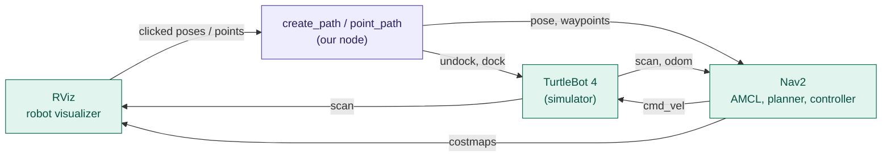

# day8pkg

Python package for CS 5335 Project 8 (TurtleBot 4 and Nav2 tutorials). Project 8 runs the
TurtleBot 4 user manual's tutorials in the Gazebo simulator: RViz, generating a map,
navigation, and the TurtleBot 4 Navigator. The last one, **Create Path**, is the part
demonstrated in class, and it is the code here:

- **`create_path`** (`ros2 run day8pkg create_path`): the tutorial's Create Path. Click
  poses in RViz with **2D Pose Estimate**, press Enter, and the robot undocks, drives through
  them with Nav2 and docks again.
- **`point_path`** (`ros2 run day8pkg point_path`): the same with **Publish Point**, which
  leaves localization alone and logs how far each point is from the previous one.

`scripts/` holds the course's simulator launchers and dock query from Canvas.

The assignment asks for a path with at least two segments of about 1 m with an angle between
them.

## The idea in short

Up to Project 7 our own nodes sent `cmd_vel`. Here Nav2 drives: it finds the robot on the map
(AMCL), plans a path on the costmaps and sends `cmd_vel` itself. Our node only says **where
to go**.

It is like taking a taxi: you tell the driver the stops, and the driver watches the road,
steers and brakes.

```text
create_path:
    collect the poses clicked in RViz until Enter
    dock if needed; reset the pose to the dock (by default (0, 0), facing +x); clear the costmaps
    undock; wait until AMCL reports a pose
    follow the poses as waypoints with Nav2
    dock
```



All of them share the costmaps, the robot model (URDF) and the TF2 frames
(`map` → `odom` → `base_link`). AMCL gives `map` → `odom`, so until it has a pose, the
costmaps cannot place the LiDAR scans on the map.

## Files

| File | What it is |
| ---- | ---------- |
| `day8pkg/create_path.py` | Node: Create Path, poses clicked with 2D Pose Estimate |
| `day8pkg/point_path.py` | Node: path from points clicked with Publish Point |
| `scripts/sim.bash` | Simulator with Nav2, localization and RViz in the warehouse world |
| `scripts/sim_depot.bash`, `scripts/sim_maze.bash` | The same in the depot and maze worlds, with their maps |
| `scripts/query_dock.bash` | Prints whether the robot is docked |

## Build

The nodes need the TurtleBot 4 navigation package (`turtlebot4_navigation`, which has
`TurtleBot4Navigator`), and the scripts need the TurtleBot 4 Gazebo simulator
(`turtlebot4_gz_bringup`). Run the simulator on a computer with a GPU (see
[Troubleshooting](#troubleshooting)).

From `robotics_ws`:

```bash
colcon build --packages-select day8pkg
source install/setup.bash
```

## Run the simulation

From `robotics_ws`:

```bash
bash src/day8pkg/scripts/sim.bash
```

Then, as in class:

1. Wait for Gazebo and RViz to start (press Play in Gazebo if it is paused).
2. Set the robot's pose with **2D Pose Estimate** in RViz.
3. Wait for the costmaps to show up.
4. Undock in Gazebo and wait for it to finish.
5. Check the dock status: `bash src/day8pkg/scripts/query_dock.bash` prints `is_docked: false`.
6. Set a goal with **Nav2 Goal** in RViz.

Stop the simulator with Ctrl-C in its terminal, not by closing its windows, or leftover
processes get in the way of the next start.

## Demo: Create Path

Plan the path first, for example an L: A → B is 1 m straight, B → C is 1 m after a 90° turn.
RViz's grid cells are 1 m (Grid display, Cell Size). Pick the points in open space, where the
costmap has no color.

1. Start the simulator fresh with `sim.bash` and leave the robot on its dock. Do **not** set a
   pose or undock by hand: `create_path` assumes the robot starts on the dock, which in the
   simulator is at the map origin.
2. In a second terminal:

   ```bash
   ros2 run day8pkg create_path
   ```

3. In RViz, choose **2D Pose Estimate** and click-drag at A with the arrow toward B, then at B
   toward C, then at C. Each click logs `Pose n added: (x, y)`. The robot jumps to each click in
   RViz, because the tool also sets AMCL's pose; `create_path` resets it later.
4. Press Enter in the `create_path` terminal. The logged points show A → B and B → C are about
   1 m, in different directions.
5. Watch it dock if needed, reset the pose to (0, 0), clear the costmaps, undock, follow
   A → B → C and dock.

The final dock expects the last pose to be near the dock. If C is far from it, add one more
point near the dock.

### With Publish Point instead

1. Start the simulator and set the pose once with **2D Pose Estimate**. The robot can stay
   docked.
2. Run `ros2 run day8pkg point_path`.
3. Click A, B and C with **Publish Point**. Each click logs its distance from the previous
   point, so 1 m segments are easy to hit. Press Enter.
4. It undocks if docked, follows the points with each pose facing the next point, and docks.

## Extra credit: lab map (real robot)

Connect to the robot (see [`related_cmds.txt`](../../../related_cmds.txt)), then:

1. Start SLAM and RViz, each in its own terminal:

   ```bash
   ros2 launch turtlebot4_navigation slam.launch.py
   ros2 launch turtlebot4_viz view_navigation.launch.py
   ```

2. Drive slowly around at least half the room with the keyboard, from a third terminal,
   watching the map fill in RViz. Keep people out of the area while mapping.

   ```bash
   ros2 run teleop_twist_keyboard teleop_twist_keyboard --ros-args -p stamped:=true
   ```

   This is [`Week1/teleop.bash`](../../../Week1/teleop.bash). On Jazzy the robot's `cmd_vel`
   takes `TwistStamped`, hence `stamped:=true`. Keep the teleop terminal focused and use:

   | Key | Motion |
   | --- | ------ |
   | `i` / `,` | Forward / backward |
   | `j` / `l` | Turn left / right in place |
   | `u` / `o` | Forward while turning left / right |
   | `k` | Stop |
   | `z` / `q` | Slower / faster (speed and turn × 0.9 / × 1.1) |

   It starts at 0.5 m/s and 1.0 rad/s (the robot caps speed at 0.31 m/s). Before mapping,
   press `z` about 9 times, to about 0.2 m/s and 0.4 rad/s; slow turns keep the map sharp.
   Hold a key to keep moving. The robot stops shortly after you let go, but press `k` to stop
   at once.
3. Save the map. This writes `lab_map.pgm` (the image) and `lab_map.yaml` to the current
   directory:

   ```bash
   ros2 service call /slam_toolbox/save_map slam_toolbox/srv/SaveMap "name:
     data: 'lab_map'"
   ```

4. Stop SLAM, then start localization with the map and Nav2, each in its own terminal:

   ```bash
   ros2 launch turtlebot4_navigation localization.launch.py map:=lab_map.yaml
   ros2 launch turtlebot4_navigation nav2.launch.py
   ```

5. In RViz, set the pose with **2D Pose Estimate** and drive with **Nav2 Goal** (or
   `point_path`).

On the real robot, clear the floor, keep it slow and have someone ready to pick it up.

### create_path on your map

`create_path` resets the robot's pose to the dock, which it takes to be at (0, 0) facing +x
unless told otherwise. On a SLAM map, (0, 0) is where the robot was when mapping started
(more exactly, where its odometry started), so it is the dock only if mapping started on the
dock. The `origin` in `lab_map.yaml` is something else: where the image's lower-left corner
is on the map.

Measure the dock's pose once, with localization, Nav2 and RViz running and the robot on the
dock:

1. Undock, so that the LiDAR turns on (the power saver turns it off on the dock). If the action
   is not found, check the names with `ros2 action list -t`.

   ```bash
   ros2 action send_goal /undock irobot_create_msgs/action/Undock "{}"
   ```

2. In RViz, set the robot's pose with **2D Pose Estimate**, and repeat until the LiDAR points
   line up with the walls on the map.
3. Dock again. AMCL follows the robot onto the dock.

   ```bash
   ros2 action send_goal /dock irobot_create_msgs/action/Dock "{}"
   ```

4. Read the robot's pose on the map, then stop it with Ctrl-C. `Translation` gives x and y in
   m, and the last number of `Rotation: in RPY (degree)` is the yaw.

   ```bash
   ros2 run tf2_ros tf2_echo map base_link
   ```

5. Pass them to `create_path`, each with a decimal point (`90.0`, not `90`), for example:

   ```bash
   ros2 run day8pkg create_path --ros-args -p dock_x:=1.25 -p dock_y:=-0.40 -p dock_yaw_deg:=90.0
   ```

The values hold as long as the dock stays put and you use the same map. If all three come out
close to 0, mapping did start on the dock and the defaults are fine.

Shifting the `origin` in `lab_map.yaml` by the dock's x and y would also move (0, 0) onto the
dock, but it cannot turn the map, so the dock's heading would still be off.

## Troubleshooting

- **The robot does not spawn**: the log keeps printing `Waiting messages on topic
  [robot_description]`, and the spawners for `joint_state_broadcaster` and
  `diffdrive_controller` die. This happened in a VMware virtual machine; run the simulator on
  a computer with a GPU.
- **Nav2 never becomes active while docked**: the power saver turns the LiDAR off on the dock,
  so AMCL cannot answer and `waitUntilNav2Active()` keeps re-publishing the pose.
  `create_path` undocks first and then waits up to 30 s for AMCL.
- **Clearing the costmaps hangs**: `clearAllCostmaps()` waits forever for the services, so
  `create_path` gives up after 3 s per costmap and goes on.
- **No topics from the simulator**: every terminal needs the same `ROS_DOMAIN_ID`, and
  `ROS_DISCOVERY_SERVER` (used for the real robot) must not be set.
