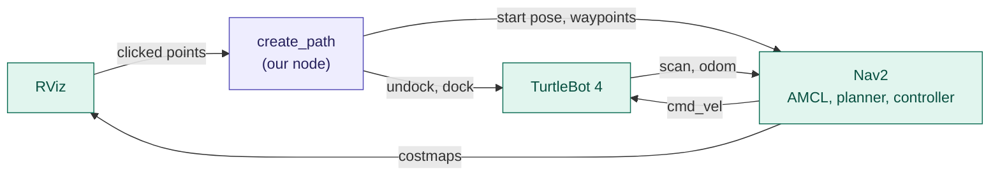

# day8pkg

Python package for CS 5335 Project 8 (TurtleBot 4 and Nav2 tutorials). The demo is the
TurtleBot 4 Navigator's
[Create Path](https://turtlebot.github.io/turtlebot4-user-manual/tutorials/turtlebot4_navigator.html#create-path):
you click a few points in RViz, and the real robot drives through them with Nav2 on a map of
the room. It needs no simulator (Gazebo).

The assignment asks for a path with at least two segments of about 1 m with an angle between
them, for example an L.

## The idea in short

Up to Project 7 our own nodes sent `cmd_vel`. Here Nav2 drives: AMCL finds the robot on the
map, the planner plans a path and the controller sends `cmd_vel`. Our node only says **where
to go**, like telling a taxi driver the stops.

```text
create_path:
    collect the points clicked in RViz (2D Pose Estimate) until Enter
    dock if needed; tell AMCL the robot is at the dock (pose from config/lab_dock.yaml)
    undock; wait until AMCL reports a pose and Nav2 is active
    drive through the points with Nav2, then dock
```



Clicking with 2D Pose Estimate also moves AMCL's estimate, so `create_path` needs a known place
to reset the robot's pose to afterwards: the dock. That is why the dock's pose on the map is
measured once and kept in `config/lab_dock.yaml`.

Nav2 is not one program but a chain of nodes (planner, controller, velocity smoother, collision
monitor, waypoint follower, ...). A lifecycle manager starts them one by one, and the robot can
only move once **all** of them are active. It can finish starting only while AMCL publishes the
robot's pose, which needs the LiDAR, so the robot must be **off the dock** then. Once active,
Nav2 stays active, also after the robot docks again. So the demo starts Nav2 first, as a
separate step, and only then runs `create_path`.

## Files

| File | What it is |
| ---- | ---------- |
| `day8pkg/create_path.py` | Node for the demo: Create Path, points clicked with 2D Pose Estimate |
| `day8pkg/point_path.py` | Other node: path from points clicked with Publish Point |
| `config/lab_dock.yaml` | The dock's pose on the lab map, for `create_path` |
| `scripts/` | The course's simulator launchers and dock query, for the [simulator](#in-the-simulator-optional) |

## 0. Before you start

**Every terminal** must have exactly the same settings, or nodes find each other slowly, answers
get lost and Nav2 hangs while starting. This robot uses a discovery server on the robot
(`10.245.131.96` is its IP; change it if the robot's IP changes). Run this in **every** terminal,
and do **not** use `ROS_DOMAIN_ID=8` from the workspace Setup for this project:

```bash
source /opt/ros/jazzy/setup.bash
export RMW_IMPLEMENTATION=rmw_fastrtps_cpp
export ROS_DOMAIN_ID=0
export ROS_DISCOVERY_SERVER=";;;;;;;;10.245.131.96:11811;"
export ROS_SUPER_CLIENT=True
export FASTDDS_BUILTIN_TRANSPORTS=UDPv4
```

To check a terminal (the output must be the same everywhere):

```bash
printenv | grep -E "ROS_DOMAIN_ID|RMW_IMPLEMENTATION|ROS_DISCOVERY_SERVER|ROS_SUPER_CLIENT|FASTDDS"
```

After changing settings, restart the ROS daemon once: `ros2 daemon stop; ros2 daemon start`.

Get the latest code and build it, in the repository:

```bash
git pull
cd robotics_ws
colcon build --packages-select day8pkg
source install/setup.bash
```

Then check the robot:

- It is reachable: `ros2 topic echo /ip` prints something.
- No node runs twice. This must print nothing but a warning line:

  ```bash
  ros2 node list | sort | uniq -d
  ```

  If it lists nodes, close extra RViz windows and leftover terminals, and if robot nodes such as
  `/turtlebot4_node` are listed, reboot the robot (`ssh ubuntu@10.245.131.96`, then
  `sudo reboot`, and wait 2 minutes).

## 1. One-time setup

Do these once. Redo A only if the room changes a lot, and B whenever the dock moves or you make
a new map. Mark the dock's place on the floor with tape so it always goes back to the same spot.

### A. Map the room

1. Put the robot on the dock. Start SLAM and RViz, each in its own terminal:

   ```bash
   ros2 launch turtlebot4_navigation slam.launch.py
   ```

   ```bash
   ros2 launch turtlebot4_viz view_navigation.launch.py
   ```

2. Undock:

   ```bash
   ros2 action send_goal /undock irobot_create_msgs/action/Undock "{}"
   ```

3. Drive slowly around the room with the keyboard, watching the map fill in RViz. Keep people
   out of the area while mapping.

   ```bash
   ros2 run teleop_twist_keyboard teleop_twist_keyboard --ros-args -p stamped:=true
   ```

   Keys (keep this terminal focused): `i` forward, `,` backward, `j` / `l` turn left / right,
   `k` stop, `z` slower. Press `z` about 9 times first, to about 0.2 m/s; slow turns keep the
   map sharp.
4. Save the map **while SLAM is still running** (it keeps the map only in memory). This writes
   `lab_map.pgm` and `lab_map.yaml` to the current directory:

   ```bash
   ros2 service call /slam_toolbox/save_map slam_toolbox/srv/SaveMap "name:
     data: 'lab_map'"
   ```

5. Stop SLAM with Ctrl-C and drive the robot back onto the dock.

### B. Measure the dock's pose

`create_path` needs the robot's pose **while it is on the dock**, in the map's coordinates. The
robot cannot measure it on the dock itself, because the LiDAR is off there (power saver). So
measure it just outside the dock, then drive back on while recording.

1. With the robot on the dock, start localization with your map (full path) and RViz, each in
   its own terminal:

   ```bash
   ros2 launch turtlebot4_navigation localization.launch.py map:=$HOME/lab_map.yaml
   ```

   ```bash
   ros2 launch turtlebot4_viz view_navigation.launch.py
   ```

2. Undock, so that the LiDAR turns on:

   ```bash
   ros2 action send_goal /undock irobot_create_msgs/action/Undock "{}"
   ```

3. In RViz, click **2D Pose Estimate** and drag an arrow where the robot is, pointing the way its
   **camera side** faces. Repeat until the red LiDAR points lie on the black walls, including
   their tilt. The room is nearly a rectangle, so an arrow pointing the wrong way (180°) can
   also put the points on the walls: check that the box near the top wall and the openings line
   up too.
4. With teleop, turn slowly about a quarter turn with `j`, back with `l`, then `k`. The red
   points should stay on the walls.
5. Start printing the robot's pose on the map, and **leave it running**:

   ```bash
   ros2 run tf2_ros tf2_echo map base_link
   ```

6. In another terminal, dock:

   ```bash
   ros2 action send_goal /dock irobot_create_msgs/action/Dock "{}"
   ```

7. Once docked, `tf2_echo` soon starts printing `Lookup would require extrapolation into the
   past`. The **last pose before those warnings** is the dock's. Take `Translation` x and y,
   and the last number of `Rotation: in RPY (degree)`.
8. Write them into `config/lab_dock.yaml`, each with a decimal point (`-6.4`, not `-6`). For
   example:

   ```yaml
   /**:
     ros__parameters:
       dock_x: 0.129       # m
       dock_y: 0.04        # m
       dock_yaw_deg: -6.4  # deg
   ```

   `create_path` reads this file from `src`, so changing it needs no rebuild.
9. Stop localization, RViz and `tf2_echo` with Ctrl-C.

## 2. Before each demo: start Nav2

Do this before the instructor watches, so that a slow start does not hold up the demo.

1. Put the robot on the dock.
2. **Terminal 1**, localization with your map:

   ```bash
   ros2 launch turtlebot4_navigation localization.launch.py map:=$HOME/lab_map.yaml
   ```

3. **Terminal 2**, RViz (only one). Wait until the map shows.

   ```bash
   ros2 launch turtlebot4_viz view_navigation.launch.py
   ```

4. **Terminal 3**, undock:

   ```bash
   ros2 action send_goal /undock irobot_create_msgs/action/Undock "{}"
   ```

5. In RViz, set the robot's pose with **2D Pose Estimate** until the red points lie on the walls
   (as in [1B](#b-measure-the-docks-pose) step 3).
6. **Terminal 4**, Nav2, saving its output to `~/nav2.log`:

   ```bash
   ros2 launch turtlebot4_navigation nav2.launch.py 2>&1 | tee ~/nav2.log
   ```

   Wait, up to about a minute, for `Managed nodes are active`. Do not run other commands on Nav2
   while it starts. If it does not come, see
   [Nav2 does not finish starting](#nav2-does-not-finish-starting).
7. **Terminal 3**, dock again. Nav2 stays active.

   ```bash
   ros2 action send_goal /dock irobot_create_msgs/action/Dock "{}"
   ```

Keep Terminals 1, 2 and 4 running for the demo.

## 3. Demo: Create Path

Clear the floor, keep people away from the path and have someone ready to pick the robot up.
Plan the path first: for example A → B is 1 m straight, B → C is 1 m after a 90° turn. In RViz
one grid cell is 1 m. Pick points in open space, away from table legs.

1. **Terminal 3**, in `robotics_ws` (after `source install/setup.bash`):

   ```bash
   ros2 run day8pkg create_path --ros-args --params-file src/day8pkg/config/lab_dock.yaml
   ```

2. In RViz, click **2D Pose Estimate** and drag at A with the arrow toward B, then at B toward
   C, then at C. Each click prints `Pose n added: (x, y)`. The robot icon jumps to each click;
   that is expected.
3. Press **Enter** in Terminal 3. It prints the points (show that A → B and B → C are about
   1 m), resets the pose to the dock, undocks, and, since Nav2 is already active, **starts
   driving right away**: `Following waypoints...`. The robot drives A → B → C and docks.

To stop the robot at any time, press Ctrl-C in Terminal 3, or pick it up.

## Troubleshooting

### Nav2 does not finish starting

`Managed nodes are active` never comes, or `create_path` keeps waiting at
`Waiting for Nav2 (waypoint_follower) to be active...`.

1. See which node it stopped at. Nav2 starts them in this order, and the first one that is not
   `active [3]` is where it hangs:

   ```bash
   for n in controller_server smoother_server planner_server behavior_server velocity_smoother collision_monitor bt_navigator waypoint_follower docking_server; do echo -n "$n: "; timeout 10 ros2 lifecycle get /$n || echo "(no answer)"; done
   ```

2. Look for the reason in the log:

   ```bash
   grep -n -E "Managed nodes|Aborting|failed to send|died|ERROR|collision_monitor" ~/nav2.log
   ```

   - `failed to send response ... (timeout): client will not receive response`: an answer
     between two nodes got lost, and the lifecycle manager waits for it forever. Usually the
     settings differ between terminals, or a node runs twice (see [step 0](#0-before-you-start)).
   - `process has died`, or one node (often `collision_monitor`) never answers: that node is
     stuck or gone.
3. Restart Nav2 cleanly: Ctrl-C in Terminal 4, then check that no Nav2 process is left (`kill`
   any that is, with the number in the second column):

   ```bash
   ps aux | grep -E "controller_server|planner_server|collision_monitor|bt_navigator|waypoint_follower|lifecycle_manager" | grep -v grep
   ```

   With the robot off the dock and its pose set, start Nav2 again ([2](#2-before-each-demo-start-nav2)
   step 6).
4. If one or two nodes are still `inactive [2]` while the rest are active, activate the rest by
   hand. **If `create_path` is waiting, the robot starts driving as soon as this succeeds.**

   ```bash
   for n in smoother_server planner_server behavior_server velocity_smoother collision_monitor bt_navigator waypoint_follower docking_server; do echo "== $n"; timeout 15 ros2 lifecycle set /$n activate; done
   ```

   Run it again if a node is still not active. Nodes that are already active just report a
   failed transition.

### Other problems

| What you see | Why | What to do |
| ------------ | --- | ---------- |
| After the undock, the red points do not lie on the walls | `lab_dock.yaml` is wrong, or the dock moved | Redo [1B](#b-measure-the-docks-pose). `create_path` gives AMCL the dock pose as certain, so AMCL does not correct a wrong one |
| The red points lie on the walls, but the robot icon faces the opposite way from the real robot (camera side) | The dock's yaw is 180° off | Add 180 to `dock_yaw_deg` (for example `-6.4` → `173.6`), or redo [1B](#b-measure-the-docks-pose) |
| `ros2 node list \| sort \| uniq -d` lists nodes | Two RViz, a leftover terminal, or the robot's software running twice | See [step 0](#0-before-you-start) |
| Nav2 keeps printing `Message Filter dropping message ... earlier than all the data in the transform cache` | The robot's two computers (Raspberry Pi and Create 3) disagree on the time | A few lines while Nav2 starts are fine. If it never stops, power the robot fully off and on: take it off the dock, hold the power button about 10 s until the lights go out, put it back on the dock, wait 2-3 minutes |
| `tf2_echo` only prints `extrapolation into the past`, never a pose | It was started after docking, when the LiDAR was already off | Start it before docking (1B step 5) |
| A `ros2` command hangs with no output | Its answer got lost | Ctrl-C and run it again; put `timeout 10` in front of it |
| `ros2 run day8pkg ...` is not found | Not built, or `install/setup.bash` not sourced | See [step 0](#0-before-you-start) |

## Extra credit: lab map

The map from [1A](#a-map-the-room) counts if it covers at least half of the room. Show the
instructor `lab_map.pgm` (or the map in RViz), then drive through the room with the demo above.

## Other ways to drive

- **Nav2 Goal**: with localization, RViz and Nav2 running and the robot undocked, set the pose
  with **2D Pose Estimate**, then click a goal with **Nav2 Goal**.
- **`point_path`**: the same as `create_path`, but you click the points with **Publish Point**,
  which does not move AMCL's pose, so it needs no `lab_dock.yaml`. Undock, set the pose with
  **2D Pose Estimate**, run `ros2 run day8pkg point_path`, click the points and press Enter.
  Each click prints its distance from the previous point.

## In the simulator (optional)

The simulator needs Gazebo and a computer with a GPU; it does not run in a virtual machine (the
robot never spawns there). It also uses no discovery server: unset `ROS_DISCOVERY_SERVER` and
`ROS_SUPER_CLIENT` in its terminals. From `robotics_ws`:

```bash
bash src/day8pkg/scripts/sim.bash
```

This one command starts Gazebo, localization, Nav2 and RViz. In the simulator the dock is at the
map origin, so run `ros2 run day8pkg create_path` with no parameters and follow
[step 3](#3-demo-create-path). Stop the simulator with Ctrl-C in its terminal, not by closing its
windows.
