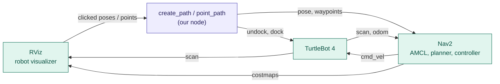

# day8pkg

Python package for CS 5335 Project 8 (TurtleBot 4 and Nav2 tutorials). Project 8 works through
the TurtleBot 4 user manual's tutorials: RViz, generating a map, navigation, and the TurtleBot 4
Navigator. The demo is the Navigator's
[Create Path](https://turtlebot.github.io/turtlebot4-user-manual/tutorials/turtlebot4_navigator.html#create-path)
on the real robot with a map of the room. Like the tutorial, it needs no simulator (Gazebo).
The code here:

- **`create_path`** (`ros2 run day8pkg create_path`): the tutorial's Create Path. Click
  poses in RViz with **2D Pose Estimate**, press Enter, and the robot undocks, drives through
  them with Nav2 and docks again.
- **`point_path`** (`ros2 run day8pkg point_path`): the same with **Publish Point**, which
  leaves localization alone and logs how far each point is from the previous one.

`scripts/` holds the course's simulator launchers and dock query from Canvas, for the
optional [simulator runs](#in-the-simulator-optional).

The assignment asks for a path with at least two segments of about 1 m with an angle between
them.

## The idea in short

Up to Project 7 our own nodes sent `cmd_vel`. Here Nav2 drives: it finds the robot on the map
(AMCL), plans a path on the costmaps and sends `cmd_vel` itself. Our node only says **where
to go**.

It is like taking a taxi: you tell the driver the stops, and the driver watches the road,
steers and brakes.

```text
create_path:
    collect the poses clicked in RViz until Enter
    dock if needed; reset the pose to the dock (by default (0, 0), facing +x); clear the costmaps
    undock; wait until AMCL reports a pose and Nav2 is active
    follow the poses as waypoints with Nav2
    dock
```



All of them share the costmaps, the robot model (URDF) and the TF2 frames
(`map` → `odom` → `base_link`). AMCL gives `map` → `odom`, so until it has a pose, the
costmaps cannot place the LiDAR scans on the map.

## Files

| File | What it is |
| ---- | ---------- |
| `day8pkg/create_path.py` | Node: Create Path, poses clicked with 2D Pose Estimate |
| `day8pkg/point_path.py` | Node: path from points clicked with Publish Point |
| `config/lab_dock.yaml` | The dock's pose on the lab map, for `create_path` |
| `scripts/sim.bash` | Simulator with Nav2, localization and RViz in the warehouse world |
| `scripts/sim_depot.bash`, `scripts/sim_maze.bash` | The same in the depot and maze worlds, with their maps |
| `scripts/query_dock.bash` | Prints whether the robot is docked |

## Build

The nodes need the TurtleBot 4 navigation package (`turtlebot4_navigation`, which has
`TurtleBot4Navigator`). Only the simulator scripts need Gazebo (`turtlebot4_gz_bringup`).

From `robotics_ws`:

```bash
colcon build --packages-select day8pkg
source install/setup.bash
```

## Demo: Create Path on the real robot

This follows the tutorial: a map of the room, then localization, Nav2 and RViz on the PC, then
`create_path`. Connect to the robot (see [`related_cmds.txt`](../../../related_cmds.txt)) and
run the [Setup](../../README.md#setup) lines in every terminal, plus `source install/setup.bash`
(in `robotics_ws`) in the one for `create_path`.

Clear the floor, keep it slow and have someone ready to pick the robot up.

### 1. Map the room (once)

Start with the robot on the dock: the map's (0, 0) is where the robot is when SLAM starts, so
`create_path` then needs no [dock pose](#3-measure-the-docks-pose-once-per-map).

1. Start SLAM and RViz, each in its own terminal, then undock:

   ```bash
   ros2 launch turtlebot4_navigation slam.launch.py
   ros2 launch turtlebot4_viz view_navigation.launch.py
   ros2 action send_goal /undock irobot_create_msgs/action/Undock "{}"
   ```

2. Drive slowly around the room with the keyboard, from another terminal, watching the map fill
   in RViz. Keep people out of the area while mapping.

   ```bash
   ros2 run teleop_twist_keyboard teleop_twist_keyboard --ros-args -p stamped:=true
   ```

   This is [`Week1/teleop.bash`](../../../Week1/teleop.bash). On Jazzy the robot's `cmd_vel`
   takes `TwistStamped`, hence `stamped:=true`. Keep the teleop terminal focused and use:

   | Key | Motion |
   | --- | ------ |
   | `i` / `,` | Forward / backward |
   | `j` / `l` | Turn left / right in place |
   | `u` / `o` | Forward while turning left / right |
   | `k` | Stop |
   | `z` / `q` | Slower / faster (speed and turn × 0.9 / × 1.1) |

   It starts at 0.5 m/s and 1.0 rad/s (the robot caps speed at 0.31 m/s). Before mapping,
   press `z` about 9 times, to about 0.2 m/s and 0.4 rad/s; slow turns keep the map sharp.
   Hold a key to keep moving. The robot stops shortly after you let go, but press `k` to stop
   at once.
3. Save the map **before** stopping SLAM, which holds it only in memory. This writes
   `lab_map.pgm` (the image) and `lab_map.yaml` to the current directory:

   ```bash
   ros2 service call /slam_toolbox/save_map slam_toolbox/srv/SaveMap "name:
     data: 'lab_map'"
   ```

4. Stop SLAM with Ctrl-C and drive the robot back onto the dock.

### 2. Start localization, Nav2 and RViz

With the robot on the dock, start these in order, each in its own terminal, letting each finish
starting before the next:

1. The map server and AMCL (localization), with the full path to your map:

   ```bash
   ros2 launch turtlebot4_navigation localization.launch.py map:=$HOME/lab_map.yaml
   ```

2. Nav2:

   ```bash
   ros2 launch turtlebot4_navigation nav2.launch.py
   ```

3. RViz:

   ```bash
   ros2 launch turtlebot4_viz view_navigation.launch.py
   ```

### 3. Measure the dock's pose (once per map)

`create_path` resets the robot's pose to the dock, which it takes to be at (0, 0) facing +x
unless told otherwise. On a SLAM map, (0, 0) is where the robot was when mapping started
(more exactly, where its odometry started), so it is the dock only if mapping started on the
dock. The `origin` in `lab_map.yaml` is something else: where the image's lower-left corner
is on the map.

Measure it once, with step 2 running and the robot on the dock:

1. Undock, so that the LiDAR turns on (the power saver turns it off on the dock). If the action
   is not found, check the names with `ros2 action list -t`.

   ```bash
   ros2 action send_goal /undock irobot_create_msgs/action/Undock "{}"
   ```

2. In RViz, set the robot's pose with **2D Pose Estimate**, and repeat until the LiDAR points
   line up with the walls on the map. Turning slowly in place with teleop (`j`, `l`) helps AMCL
   settle.
3. Start printing the robot's pose on the map, and leave it running:

   ```bash
   ros2 run tf2_ros tf2_echo map base_link
   ```

4. In another terminal, dock. AMCL follows the robot onto the dock.

   ```bash
   ros2 action send_goal /dock irobot_create_msgs/action/Dock "{}"
   ```

   On the dock the LiDAR turns off and AMCL stops updating `map` → `odom`, so a little later
   `tf2_echo` starts printing `Lookup would require extrapolation into the past`. The last pose
   it printed before that is the dock's (the pose on the dock, not where the robot stops after
   undocking): `Translation` gives x and y in m, and the last number
   of `Rotation: in RPY (degree)` is the yaw. Stop it with Ctrl-C. (Started only after docking,
   `tf2_echo` never prints a pose, because it has no data from before the LiDAR turned off.)
5. Write them into [`config/lab_dock.yaml`](config/lab_dock.yaml), each with a decimal point
   (`90.0`, not `90`).

From then on `create_path` reads the dock's pose from that file, so there is nothing to click
or measure again as long as the dock stays put and you use the same map. If all three values
come out close to 0, mapping did start on the dock and the file can stay at zero.

Shifting the `origin` in `lab_map.yaml` by the dock's x and y would also move (0, 0) onto the
dock, but it cannot turn the map, so the dock's heading would still be off.

### 4. Run create_path

Plan the path first, for example an L: A → B is 1 m straight, B → C is 1 m after a 90° turn.
RViz's grid cells are 1 m (Grid display, Cell Size). Pick the points in open space, where the
costmap has no color.

1. Leave the robot on its dock. Do **not** set a pose or undock by hand: `create_path` does
   both.
2. Run it from `robotics_ws` with the dock's pose from step 3. Editing the file needs no
   rebuild, since this reads it from `src`.

   ```bash
   ros2 run day8pkg create_path --ros-args --params-file src/day8pkg/config/lab_dock.yaml
   ```

3. In RViz, choose **2D Pose Estimate** and click-drag at A with the arrow toward B, then at B
   toward C, then at C. Each click logs `Pose n added: (x, y)`. The robot jumps to each click in
   RViz, because the tool also sets AMCL's pose; `create_path` resets it later.
4. Press Enter in the `create_path` terminal. The logged points show A → B and B → C are about
   1 m, in different directions.
5. Watch it dock if needed, reset the pose to the dock, clear the costmaps, undock, follow
   A → B → C and dock.

The final dock expects the last pose to be near the dock. If C is far from it, add one more
point near the dock.

### With Publish Point instead

This needs no dock pose, because it never resets the robot's pose.

1. With step 2 running, undock, then set the robot's pose with **2D Pose Estimate** until the
   LiDAR points line up with the walls on the map.
2. Run `ros2 run day8pkg point_path`.
3. Click A, B and C with **Publish Point**. Each click logs its distance from the previous
   point, so 1 m segments are easy to hit. Press Enter.
4. It follows the points with each pose facing the next point, and docks.

## Extra credit: lab map

The map from [step 1](#1-map-the-room-once) counts if it covers at least half of the room.
Show the instructor `lab_map.pgm` (or the map in RViz), then drive through the mapped area with
`create_path`, or set the pose with **2D Pose Estimate** and drive with **Nav2 Goal**.

## In the simulator (optional)

The simulator needs Gazebo and a computer with a GPU; it does not run in a virtual machine (see
[Troubleshooting](#troubleshooting)). From `robotics_ws`:

```bash
bash src/day8pkg/scripts/sim.bash
```

This one command starts everything `create_path` needs: Gazebo, the map server and AMCL
(`localization:=true`), Nav2 (`nav2:=true`) and RViz (`rviz:=true`).

Then, as in class:

1. Wait for Gazebo and RViz to start (press Play in Gazebo if it is paused).
2. Set the robot's pose with **2D Pose Estimate** in RViz.
3. Wait for the costmaps to show up.
4. Undock in Gazebo and wait for it to finish.
5. Check the dock status: `bash src/day8pkg/scripts/query_dock.bash` prints `is_docked: false`.
6. Set a goal with **Nav2 Goal** in RViz.

To run `create_path` in the simulator, start it fresh, leave the robot on its dock (which is at
the map origin there) and run `ros2 run day8pkg create_path` without parameters, then follow
[step 4](#4-run-create_path) from 3 on.

Stop the simulator with Ctrl-C in its terminal, not by closing its windows, or leftover
processes get in the way of the next start.

## Troubleshooting

- **Nav2 never becomes active while docked**: the power saver turns the LiDAR off on the dock,
  so AMCL cannot answer and `waitUntilNav2Active()` keeps re-publishing the pose.
  `create_path` undocks first and then waits up to 30 s for AMCL.
- **`Following N waypoints request was rejected!`**: Nav2's `waypoint_follower` was not active
  yet (its terminal says `Action server is inactive. Rejecting the goal.`). Nav2 can only
  finish starting once AMCL gives `map` → `odom`, after the undock, so `create_path` waits for
  `waypoint_follower` to be active before sending the path.
- **Clearing the costmaps hangs**: `clearAllCostmaps()` waits forever for the services, so
  `create_path` gives up after 3 s per costmap and goes on.
- **No topics**: every terminal needs the same `ROS_DOMAIN_ID`. For the simulator,
  `ROS_DISCOVERY_SERVER` (used for the real robot) must not be set.
- **The simulated robot does not spawn**: the log keeps printing `Waiting messages on topic
  [robot_description]`, and the spawners for `joint_state_broadcaster` and
  `diffdrive_controller` die. This happened in a VMware virtual machine; run the simulator on
  a computer with a GPU.
