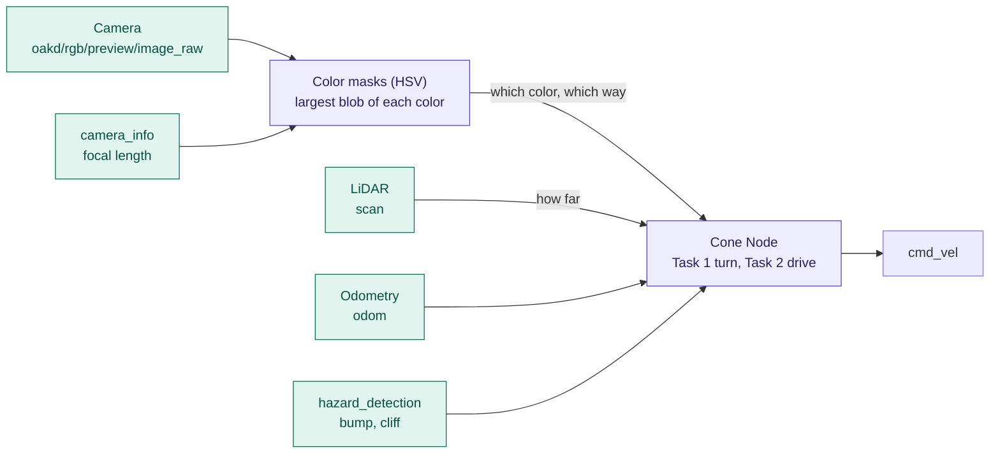

# day9pkg

Python package for CS 5335 Project 9 (Computer Vision). One node, the **Cone Node**
(`ros2 run day9pkg cones`), does both tasks:

- **Task 1**: turns the TurtleBot 4 once around in place, finds the three colored traffic
  cones in the camera image as it turns, names each one's color, and says which way and how
  far each one is.
- **Task 2**: in a loop, asks you for a color and drives to about an inch from that cone
  without touching it.

## The idea in short

The camera can tell **which** object is the orange cone and **which way** it is, but not
well how far away it is, and up close it no longer sees the whole cone. The LiDAR is the
opposite: it measures distance to within millimeters but sees no color. So the camera
points, and the LiDAR measures.

It is like finding a friend in a crowd by their orange jacket: your eyes pick them out and
tell you which way to walk, and then you just keep walking toward that person until you are
right in front of them.

```text
Task 1:
    turn 360 degrees slowly
        for each camera image: for each color, find the largest patch of that color
        keep each color's best view, and which way the robot faced then
    stop; in a LiDAR scan, the nearest object in each color's direction is that cone
    print each cone's color, direction and distance

Task 2, until q:
    ask for a color
    turn toward where that cone is
    turn until the cone is in the middle of the camera image     <- camera
    the nearest LiDAR object straight ahead is the cone          <- LiDAR
    drive to it, following it in the LiDAR scans, and stop about an inch away
```



The code is in three files: `vision.py` (finding colors in an image, no ROS),
`geometry.py` (LiDAR points, gaps and motion commands, no ROS) and `cones.py` (the node).

## How the camera finds a cone

1. **HSV, not RGB.** Each pixel is converted from BGR to HSV: hue (which color),
   saturation (how strong) and value (how bright). A cone's hue stays about the same in light
   and shadow, while its RGB values all change, so a hue range picks out a color much better
   than an RGB range. OpenCV's hue runs 0-179 (degrees / 2); red sits at both ends, so its
   range wraps through 0.
2. **A mask per color.** Every pixel inside that color's range `[h_lo, s_lo, v_lo, h_hi,
   s_hi, v_hi]` becomes white, the rest black. The low saturation limit keeps out gray
   floors, white walls and the cone's white stripe.
3. **Clean it up.** An opening (erode, then dilate) removes specks of noise; a closing
   (dilate, then erode) fills small holes.
4. **The largest cone-shaped region is the cone.** Regions smaller than `min_area` pixels
   are ignored. A cone's white stripe cuts it into two pieces, one above the other, so
   pieces in the same columns are joined back into one blob. Regions are tried from the
   largest down, and the first one shaped like a cone wins (`shape_check`, on by default):
   - height / width within `[min_aspect, max_aspect]`;
   - **taper** (1 - top third's width / bottom third's width) of at least `min_taper`: a
     cone is narrower at the top, while a box or a ball is about 0;
   - left-right **symmetry** of at least `min_symmetry`;
   - **solidity** (pixel count / convex hull area) of at least `min_solidity`.

   So a red box or a blue ball next to the cones is skipped. With `shape_check: false`, the
   largest region of the color counts, whatever its shape.
5. **Which way it is.** With the pinhole camera model from class, a point x to the side at
   depth z lands on image column u = cx + fx·x / z. So the blob's center column u is at the
   angle atan((cx − u) / fx) from straight ahead (+ = left). The focal length fx and center
   cx come from `camera_info`.

Why not YOLO: its standard (COCO) classes have no traffic cone, and the cones here differ only
by color anyway. Why not the depth image: it is off by default on the TurtleBot 4 (Day 9
slides), and the LiDAR already measures distance.

## How it drives to a cone

1. **Face it.** Turn in place toward where Task 1 (or the last drive) put the cone in the odom
   frame, to within 5 degrees.
2. **Center it in the image.** Turn proportionally to the cone's angle in the image until it
   is within `center_tolerance` (2 degrees) of the center, then stop and check again in a still
   image (no motion blur, no lag). If the cone is not in view, it turns left until it is, for
   at most one full turn.
3. **Lock on with the LiDAR.** In a still scan, look in the directions the cone covers in the
   image (plus `bearing_margin`, 4 degrees, each side). The nearest points there are the cone
   (the wall behind it is farther). Their mean is the cone's position in the odom frame.
4. **Drive to it.** With each new scan, the points within 20 cm of the cone's last position
   are the cone, and their mean is its new position, so the robot keeps following it even when
   it is too close for the camera to see it whole. Every control period (20 Hz), those points
   seen from where odometry says the robot is now give:
   - the **direction** to steer: turn in place if the cone is more than 20 degrees off,
     otherwise drive and steer at once;
   - the **gap**: the distance from the robot's center to the nearest cone point minus the
     robot's radius (the TurtleBot 4 is round, 0.342 m across, so this works from any side).

   Speed is proportional to the gap still to close (0.5 m/s per meter), at most 0.15 m/s,
   at least 0.02 m/s near the end, and it stops when the gap is small enough.

**Where it stops.** The LiDAR sees the cone about 19 cm above the floor, where the cone is
narrower than at its base, but the robot's bumper is at the bottom. So the robot stops when
the LiDAR's gap is `stop_gap` + `cone_base_extra`:

```text
              LiDAR (about 19 cm up)
   robot  |<--- gap the LiDAR measures --->/  cone side at 19 cm
          |                               /
          |                             /
  bumper  |<-- stop_gap -->|<- cone_base_extra ->|  base
```

`stop_gap` (default 2.5 cm, about an inch) is the gap you want; `cone_base_extra` (default
6 cm) is how much farther the base sticks out than the cone's side at the LiDAR's height,
which you measure once on your cones (see below).

## Set up in the lab

- Three cones of different colors in a triangle, at least 1.5 m apart, with nothing else
  inside the triangle.
- The cones must be taller than the LiDAR (about 20 cm), or the LiDAR cannot see them.
- The robot undocked, near the center of the triangle.

## Build

The node needs `cv_bridge` (to turn ROS images into OpenCV images), OpenCV, NumPy and the
Create 3's messages. From the workspace root (`robotics_ws`):

```bash
rosdep install -i --from-path src/day9pkg --rosdistro jazzy -y
```

```bash
colcon build --packages-select day9pkg
source install/setup.bash
```

## Run

From the workspace root, so the parameter file can be edited without rebuilding:

```bash
ros2 run day9pkg cones --ros-args --params-file src/day9pkg/config/cones.yaml
```

It waits for odometry, LiDAR scans and camera images, does Task 1, and then asks for a color
(the whole name or its start, e.g. `or`); `s` scans again from where the robot is, `q`
quits. Example from an offline simulation (not the robot):

```text
Task 1: turning 360 degrees to look for the cones...
  saw orange
  saw green
  saw blue

Cones found (direction from the robot now: 0 = ahead, + = left; distance from its center to the near side of the cone):
  orange     +46 deg  0.98 m   image: ./cone_orange.png
  green     +166 deg  0.98 m   image: ./cone_green.png
  blue       -69 deg  1.01 m   image: ./cone_blue.png

Drive to which cone? (orange, green, blue; s = scan again, q = quit) > blue

Driving to the blue cone...
Cone 1.00 m from the center of the robot; driving to it
Arrived: about 2.3 cm from the base of the blue cone (7.5 cm at the height of the LiDAR)
```

Task 1 saves each cone's best camera image, with its color name boxed, as
`cone_<color>.png` in `output_dir` (default: the current directory).

The camera window (`Cones`) shows the live image with each color's cone boxed and a yellow
line at the image's center. It runs in a thread of its own, so a slow window cannot hold up
the odometry and scans while the robot moves. Turn it off with `-p display:=false` (for
example over SSH).

## Tune it in the lab

All of these are in `config/cones.yaml`; edit, then run again (no rebuild).

1. **Colors.** Set `colors` to your three cones' colors (from red, orange, yellow, green,
   blue, purple, pink). Run the node, and click on each cone in the camera window: the
   terminal prints the HSV values around that pixel. Set that color's `hsv` range a little
   wider than what you see (about ±5 in H, and S and V lower limits 30-50 below), and check
   in the window that each cone gets a box and nothing else does. If a color is boxed on
   something that is not a cone, narrow its range or raise `min_area`.

   Then the shape: if a cone of the right color gets no box, loosen the shape limits (for
   a short, wide cone, lower `min_aspect`; for a cone with a wide white stripe, lower
   `min_solidity`). To check whether the shape is what stops it, run once with
   `-p shape_check:=false`.
2. **`cone_base_extra`.** On one cone, measure half the base's width, and the cone's radius
   about 19 cm up (half its width there). `cone_base_extra` is the difference. For a square
   base, the half-width depends on which way the cone is turned, so use the larger
   (corner-to-center) value to be safe.
3. **`stop_gap`.** Drive to a cone, measure the gap at the base with a ruler, and adjust.

## Safety

The robot stops (zero velocity, sent three times) on every exit: when a drive finishes, on
`q`, Ctrl-C or a closed terminal, and on any of:

| Event | Limit |
| --- | --- |
| Bump, cliff, wheel stall or wheel drop (`hazard_detection`) | at once |
| Odometry or LiDAR scans stop arriving | older than `data_timeout`, 0.5 s |
| The LiDAR loses the cone | 1 s |
| One move takes too long | `move_timeout`, 60 s |

Speeds stay at or below 0.15 m/s and 0.8 rad/s (`max_linear_speed`, `max_angular_speed`;
the TurtleBot 4 can do 0.31 m/s and 1.9 rad/s). The Create 3's own protections stay on.
Test first with someone ready to lift the robot.

The tasks run in the main thread (so `input()` can wait for you) and send `cmd_vel`
themselves; the ROS callbacks run in a background thread and only store the latest data.
Ctrl-C is handled by the node rather than by ROS, so the stop command still goes out before
ROS shuts down.

## Testing without the robot

The image and geometry functions have tests on synthetic images and points, including a
simulated drive up to a cone. From this package's directory (`robotics_ws/src/day9pkg`):

```bash
python3 -m pytest test/test_vision.py test/test_geometry.py
```

## Check on the robot first

Not yet tested on the robot or built with colcon. Check these first:

| What | How |
| --- | --- |
| The camera's preview topic exists and has images | `ros2 topic hz /oakd/rgb/preview/image_raw` |
| `camera_info` has a real focal length (`k[0]` > 0); otherwise `hfov` (69 deg) is used | `timeout 5 ros2 topic echo /oakd/rgb/preview/camera_info --once` |
| `cmd_vel` takes `TwistStamped` | `ros2 topic info -v /cmd_vel` |
| `hazard_detection` gets through the Discovery Server (if not, the bump stop is off) | `timeout 5 ros2 topic echo /hazard_detection --once` |
| The hazard type numbers | `ros2 interface show irobot_create_msgs/msg/HazardDetection` |
| The LiDAR's height (the cones must be taller) | `ros2 run tf2_ros tf2_echo base_link rplidar_link` |
| The camera is on the robot's center line and faces straight ahead (the direction math assumes it) | `ros2 run tf2_ros tf2_echo base_link oakd_rgb_camera_frame` (y ≈ 0, no yaw; frame names from `ros2 run tf2_tools view_frames`) |
| `cv_bridge` is installed | `python3 -c "import cv_bridge"` |
| The camera window opens (it is drawn in its own thread) | if not, run with `-p display:=false` and look at `cone_<color>.png` |
| If Task 1 stops partway through the turn, the message says why: `odometry (odom) stopped arriving` (data late over Wi-Fi), `... detected` (a hazard), or `the turn took too long` | the text after `Task 1 stopped:` |
